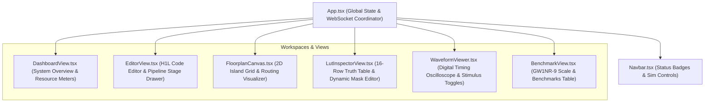

# FPGA-H1 Virtual Lab — Frontend Design & User Interface Architecture

## 1. Design Overview

The FPGA-H1 Virtual Lab frontend is engineered with React 19, TypeScript, and Vite. It adheres to strict professional EDA (Electronic Design Automation) standards:
- **Clean Dark Theme**: High contrast cyber-engineering aesthetic inspired by high-end oscilloscopes and chip layout software.
- **Hardware-Direct Data Binding**: Zero mock data; every waveform edge, truth table bit, and floorplan tile maps directly to real backend execution.
- **Reactive Performance**: Fast UI transitions, low memory footprint, and virtualized HTML5 canvas graphics.

---

## 2. Component Hierarchy

---

## 3. Key Components Specification

### 3.1 `Navbar.tsx`
- **Global Hardware Status**:
  - Displays compiled Device Name, LUT4 count, CLB count, DFF count, and Bitstream CRC32.
- **Navigation Tabs**:
  - Seamlessly switches between Dashboard, H1L Studio, Floorplan, LUT Inspector, Waveform, and GW1NR-9 Scale.
- **Interactive Simulator Bar**:
  - Run/Pause, Step Forward, Reset buttons.
  - Clock frequency selector: 0.5 Hz, 1 Hz, 2 Hz, 5 Hz, 10 Hz.
  - Cycle Counter $T=N$.
  - "Build Bitstream" compilation trigger.

### 3.2 `EditorView.tsx` (H1L Studio)
- **Monospace Code Editor**:
  - Line numbers, project naming, and persistence controls.
  - Real-time syntax and structural error reporting from elaborator.
- **Compilation Pipeline Stage Drawer**:
  - Inspect intermediate outputs from all 8 compilation stages:
    1. **Lexer**: Token type, value, line, column.
    2. **Parser**: AST root and node counts.
    3. **Elaborator**: Signal widths, input/output port assignments, registers.
    4. **Optimizer**: Mapped LUT4 truth table masks and DFF connections.
    5. **Netlist**: CircuitEngine graph topology.
    6. **Placement**: CLB grid coordinates $(x, y)$.
    7. **Routing**: Wilton switch box traces, segments used, congestion iterations.
    8. **H1BS Bitstream**: Hex stream preview and one-click `.h1bs` download.

### 3.3 `FloorplanCanvas.tsx`
- **Virtualized HTML5 Canvas Engine**:
  - Renders 2D Island-Style FPGA array: CLBs (with 4 BLEs each), horizontal and vertical routing channels, and Wilton switch boxes ($F_s=3$).
  - **Pan & Zoom**: Smooth mouse drag and wheel zoom with reset controls.
  - **Minimap**: Bottom-right HUD showing global chip overview and active viewport bounding box.
  - **Level of Detail (LOD)**: Automatically adjusts detail rendering when zoomed out (culls internal BLE pins when scale $< 0.35$).
  - **Net Overlay**: Renders routed net connections from source BLE pins to sink BLE inputs with Manhattan routing paths.
  - **Click Selection**: Clicking any BLE selects it and navigates to the LUT Inspector.
  - **Scale Exploration**: Dynamic dropdown allowing switching visual grid dimensions from $4 \times 4$ up to $47 \times 47$ (GW1NR-9 reference scale, 8,640 LUT4).

### 3.4 `LutInspectorView.tsx`
- **16-Row Truth Table**:
  - Visualizes all $2^4 = 16$ minterms ($I_3, I_2, I_1, I_0 \to O$).
  - Highlights currently active row based on live inputs during simulation.
  - **Live Logic Modification**: Clicking any truth table output bit immediately flips the bit, recalculates the 16-bit hexadecimal mask, and sends a REST/WebSocket update to modify the live circuit without restarting!
- **Pin Indicators**:
  - Real-time input pins $I_0..I_3$, LUT combinational output, and DFF register state $Q$.

### 3.5 `WaveformViewer.tsx`
- **Digital Logic Oscilloscope**:
  - Left panel shows signal tree: Clock (`CLK`), Inputs (`A[0]..A[3]`, `B[0]..B[3]`, `OP[0]..OP[2]`), and Outputs (`RES[0]..RES[3]`, `ZERO`, `NEG`).
  - Right scrollable canvas renders digital square waveforms with sharp vertical clock edges.
  - **Interactive Stimulus**: Users can toggle input signal values directly by clicking the 0/1 badges next to signal names to inject stimulus for upcoming clock cycles.

### 3.6 `BenchmarkView.tsx`
- **Gowin GW1NR-9 Comparison Card**:
  - Comprehensive comparison matrix against the Sipeed Tang Nano 9K reference chip.
- **Empirical Scalability Table**:
  - Real execution times and memory measurements from SQLite across 6 tiers (Nano-4, Micro-64, Standard-256, Medium-1024, Large-4096, GW1NR9-8640).
  - Button to re-execute benchmark suite.
