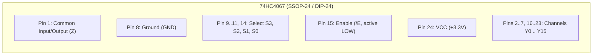

# FPGA-H1 — Phase 6.1: Discrete Component Electrical Audit & Datasheet Analysis

## 1. Executive Summary & Audit Scope

Phase 6 established the preliminary discrete architecture for **`FPGA-H1-PROTOTYPE-001`**. This audit subjects every selected component to an exhaustive electrical inspection using official manufacturer datasheets (Texas Instruments, NXP, Raspberry Pi Foundation) to identify and rectify hidden electrical incompatibilities before PCB layout and physical fabrication.

> [!IMPORTANT]
> **Audit Finding (Voltage Threshold Mismatch)**:
> Operating the 74HC discrete logic at $V_{CC} = 5.0\text{V}$ while communicating with the 3.3V RP2040 microcontroller violates standard CMOS input threshold specifications ($V_{IH,\text{min}} = 0.7 \times 5.0\text{V} = 3.5\text{V} > 3.3\text{V}$).
> **Remedy**: The entire `FPGA-H1-PROTOTYPE-001` board is unified at **$V_{CC} = 3.3\text{V}$**. At 3.3V, $V_{IH,\text{min}} = 2.31\text{V}$, providing an ample 0.89V noise margin for RP2040 signals with zero level translators.

---

## 2. Datasheet Analysis: 74HC4067 (16-Channel Analog/Digital Multiplexer)

- **Manufacturer & Reference**: Texas Instruments (Doc `SCHS209G`), NXP (`74HC_HCT4067 v.7`).
- **Function in FPGA-H1**: Primary 16:1 Look-Up Table evaluation tree.

### Electrical Parameters @ $V_{CC} = 3.3\text{V}$ ($T_A = 25^\circ\text{C}$)

| Parameter | Symbol | Min | Typ | Max | Units | Datasheet Note |
| :--- | :--- | :---: | :---: | :---: | :---: | :--- |
| **Supply Voltage Range** | $V_{CC}$ | 2.0 | 3.3 | 6.0 | V | Recommended operating range |
| **High-Level Input Voltage** | $V_{IH}$ (Select, /E) | 2.31 | — | — | V | $0.7 \times V_{CC}$ |
| **Low-Level Input Voltage** | $V_{IL}$ (Select, /E) | — | — | 0.99 | V | $0.3 \times V_{CC}$ |
| **On-Resistance (Switch)** | $R_{\text{ON}}$ | — | 110 | 180 | $\Omega$ | Path from $Y_k$ to $Z$ at $V_I = V_{CC}/2$ |
| **Propagation Delay ($Y_k \to Z$)**| $t_{pd(I-O)}$ | — | 6.0 | 12.0 | ns | Pure analog switch delay |
| **Propagation Delay ($S_k \to Z$)**| $t_{pd(S-O)}$ | — | 22.0 | 45.0 | ns | Address decoding logic delay |
| **Enable Turn-Off Delay** | $t_{PZ}$ | — | 18.0 | 36.0 | ns | High-impedance isolation |
| **Input Capacitance (Pins $Y_k$)**| $C_S$ | — | 5.0 | 8.0 | pF | Single channel off-capacitance |
| **Common Output Capacitance** | $C_D$ (Pin $Z$) | — | 45.0 | 60.0 | pF | Sum of all internal switch nodes |
| **Quiescent Supply Current** | $I_{CC}$ | — | — | 8.0 | $\mu\text{A}$ | Static leakage |

### Critical Architectural Notes:
1. **Analog Switch Structure**: The 74HC4067 is an analog transmission-gate switch array, **not a digital push-pull buffer**. The signal driving channel pin $Y_k$ (from the 74HC595 shift register output) drives the output $Z$ directly through $R_{\text{ON}} \approx 110 \ \Omega$.
2. **Output Drive Restorer**: To prevent slew-rate degradation and capacitive loading on downstream routing, the common terminal $Z$ of each LUT4 must be buffered before driving interconnect lines.

---

## 3. Datasheet Analysis: 74HC595 (8-Bit Shift Register with 3-State Latches)

- **Manufacturer & Reference**: Texas Instruments (`SCLS041I`).
- **Function in FPGA-H1**: 16-bit LUT mask storage and BLE architectural configuration latch.

### Pinout Specification (SOIC-16 / DIP-16)
- **Pin 14 (`SER` / `DS`)**: Serial data input.
- **Pin 11 (`SRCLK` / `SCK`)**: Shift register clock (shifts on rising edge).
- **Pin 12 (`RCLK` / `LATCH`)**: Storage register clock (latches on rising edge).
- **Pin 10 (`/SRCLR`)**: Shift register clear (active LOW, tied to $V_{CC}$ via 10k resistor).
- **Pin 13 (`/OE`)**: Output enable (active LOW, tied to GND or RP2040 control).
- **Pin 9 (`QH'` / `Q7S`)**: Serial cascade output to daisy-chain downstream 74HC595s.
- **Pins 15, 1..7 ($Q_A .. Q_H$)**: 8-bit parallel outputs driving LUT4 configuration pins.

### Electrical Parameters @ $V_{CC} = 3.3\text{V}$

| Parameter | Symbol | Min | Typ | Max | Units | Datasheet Note |
| :--- | :--- | :---: | :---: | :---: | :---: | :--- |
| **Output High Voltage** | $V_{OH}$ ($I_{OH} = -4\text{ mA}$) | 2.85 | 3.15 | — | V | Solid CMOS high driving 74HC4067 |
| **Output Low Voltage** | $V_{OL}$ ($I_{OL} = 4\text{ mA}$) | — | 0.12 | 0.33 | V | Solid CMOS low |
| **Max Shift Clock Frequency** | $f_{\text{max}}$ | 20 | 45 | — | MHz | Supports SPI shift at 10–20 MHz |
| **Data Setup Time (`SER` to `SRCLK`)**| $t_{su}$ | 12 | 5 | — | ns | Required margin for SPI `MOSI` |
| **Data Hold Time (`SER` to `SRCLK`)** | $t_h$ | 4 | 1 | — | ns | Required margin for SPI `MOSI` |
| **Register Latch Pulse Width**| $t_w(\text{RCLK})$ | 14 | 6 | — | ns | Minimum pulse on `CFG_LATCH` |

---

## 4. Datasheet Analysis: 74HC74 (Dual D-Type Flip-Flop with Set and Reset)

- **Manufacturer & Reference**: Texas Instruments (`SCLS046J`).
- **Function in FPGA-H1**: 4 sequential BLE state storage registers.

### Electrical Parameters @ $V_{CC} = 3.3\text{V}$

| Parameter | Symbol | Min | Typ | Max | Units | Datasheet Note |
| :--- | :--- | :---: | :---: | :---: | :---: | :--- |
| **Clock Frequency** | $f_{\text{max}}$ | 21 | 50 | — | MHz | Maximum register clocking rate |
| **Data Setup Time ($D \to \text{CLK}$)**| $t_{su}$ | 14 | 6 | — | ns | Data must be stable prior to edge |
| **Data Hold Time ($D \to \text{CLK}$)** | $t_h$ | 3 | 0 | — | ns | Data hold requirement |
| **Propagation Delay ($\text{CLK} \to Q$)**| $t_{pd}$ | — | 18 | 32 | ns | Output response time |
| **Reset Removal Time ($t_{rem}$)**| $t_{rem}$ | 12 | 4 | — | ns | Recovery time after asynchronous clear |

> [!WARNING]
> **Asynchronous vs Synchronous Clear**:
> The 74HC74 pins `/CLR` (Pin 1/13) and `/PRE` (Pin 4/10) are **strictly asynchronous level-sensitive inputs**. Pulling `/CLR` low forces $Q \to 0$ immediately, overriding the clock. Section 4 provides the gating logic required to achieve synchronous reset.

---

## 5. Datasheet Analysis: 74HC157 (Quad 2:1 Multiplexer) vs 74HC4053

- **74HC157 Limitation**:
  - The 74HC157 integrates four 2:1 multiplexers, but **all 4 multiplexers share a single select pin (`S`, Pin 1)**.
  - If a 74HC157 is used for the four BLE Bypass multiplexers, it is physically impossible to configure BLE0 as combinational while configuring BLE1 as registered.
- **Solution — 74HC4053 (Triple 2-Channel Multiplexer with Independent Selects)**:
  - 16-pin package containing 3 independent 2:1 switches ($A, B, C$).
  - Each switch has its own dedicated select pin: $S_A$ (Pin 11), $S_B$ (Pin 10), $S_C$ (Pin 9).
  - With two 74HC4053 ICs, we obtain **6 completely independent 2:1 multiplexers**, enabling independent bypass and carry configuration for all 4 BLEs.

---

## 6. RP2040 Microcontroller Interface Compatibility

- **Logic Levels**: 3.3V LVCMOS.
- **Current Drive**: Configurable 2 mA, 4 mA, 8 mA, 12 mA per GPIO pin.
- **SPI Interface (SPI0 / SPI1)**: Up to 62.5 MHz bit rate.
- **Coupling to Fabric**:
  - `GPIO 16` $\to$ `CFG_MOSI` (74HC595 Pin 14)
  - `GPIO 18` $\to$ `CFG_SCK` (74HC595 Pin 11)
  - `GPIO 19` $\to$ `CFG_LATCH` (74HC595 Pin 12)
  - `GPIO 20` $\to$ `CFG_OE_N` (74HC595 Pin 13, active LOW)
  - `GPIO 21` $\to$ `FABRIC_RESET_N` (74HC74 Pin 1/13 `/CLR`)
  - `GPIO 22` $\to$ `FABRIC_CLK` (Global clock generator)
