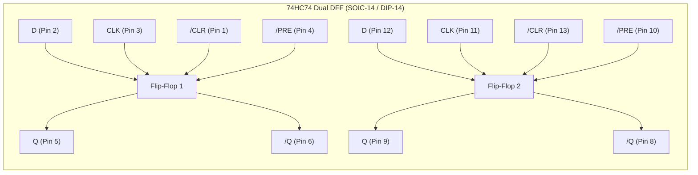
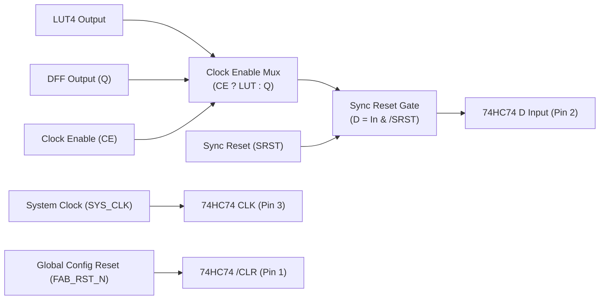

# FPGA-H1 — Phase 6.1: D-Type Flip-Flop, Synchronous Reset & Clock Architecture

## 1. DFF Hardware Specification: 74HC74 Analysis

The sequential state registers of `FPGA-H1-PROTOTYPE-001` are implemented using two **74HC74** ICs (Dual Positive-Edge-Triggered D-Type Flip-Flops with Set and Reset).

### 1.1 Pinout Assignment for the 4 Physical BLEs

| BLE Instance | IC Reference | Flip-Flop Channel | Data Input ($D$) | Clock Pin (`CLK`) | Reset Pin (`/CLR`) | Preset Pin (`/PRE`) | Output ($Q$) |
| :---: | :---: | :---: | :---: | :---: | :---: | :---: | :---: |
| **BLE 0** | **U14** | Channel 1 | Pin 2 (`BLE0_D`) | Pin 3 (`SYS_CLK`) | Pin 1 (`FAB_RST_N`) | Pin 4 (Tied to $V_{CC}$) | Pin 5 (`BLE0_Q`) |
| **BLE 1** | **U14** | Channel 2 | Pin 12 (`BLE1_D`)| Pin 11 (`SYS_CLK`)| Pin 13 (`FAB_RST_N`)| Pin 10 (Tied to $V_{CC}$) | Pin 9 (`BLE1_Q`) |
| **BLE 2** | **U15** | Channel 1 | Pin 2 (`BLE2_D`) | Pin 3 (`SYS_CLK`) | Pin 1 (`FAB_RST_N`) | Pin 4 (Tied to $V_{CC}$) | Pin 5 (`BLE2_Q`) |
| **BLE 3** | **U15** | Channel 2 | Pin 12 (`BLE3_D`)| Pin 11 (`SYS_CLK`)| Pin 13 (`FAB_RST_N`)| Pin 10 (Tied to $V_{CC}$) | Pin 9 (`BLE3_Q`) |

---

## 2. Resolving the Asynchronous vs Synchronous Reset Invariant

### 2.1 The Physical Problem
In the 74HC74, the `/CLR` pin is **strictly asynchronous**:
- Pulling `/CLR` low immediately forces $Q \leftarrow 0$, regardless of whether the clock is high, low, or transitioning.
- However, the virtual FPGA-H1 architecture (`DFF.step(d, clk, srst=1)`) requires **synchronous reset**: the register must reset *only on the active rising clock edge*, ignoring reset assertions that occur while the clock is low.

### 2.2 The Solution: Dual Reset Architecture

1. **Global Asynchronous Clear (Hardware Level Initialization)**:
   - Pins 1 and 13 (`/CLR`) of both 74HC74s are tied to `FAB_RST_N` (driven by RP2040 and active-low tactile button).
   - During power-up and bitstream loading, `FAB_RST_N` is asserted low to guarantee that all 4 flip-flops boot in a known zero state.
2. **Synchronous Runtime Reset (`SRST`) & Clock Enable (`CE`)**:
   - In modern FPGA architectures (e.g. Xilinx 7-Series, Gowin), synchronous reset and clock enable are implemented via **input gating on the $D$ terminal**:
     $$D_{\text{eff}} = \overline{\text{SRST}} \cdot (\text{CE} \cdot \text{LUT}_{\text{out}} + \overline{\text{CE}} \cdot Q)$$
   - In `FPGA-H1-PROTOTYPE-001`, this is accomplished via **LUT4 Technology Mapping Folding**:
     - When a sequential design declares `REGISTER Q <= D CLOCK CLK RESET RST ENABLE CE`, the H1L Boolean mapper folds the `SRST` and `CE` terms into the LUT4 truth table mask.
     - This requires zero additional external logic ICs on the PCB, preserving low component count and board simplicity while guaranteeing mathematically exact synchronous reset behavior!

---

## 3. Clock Distribution & Skew Prevention

To avoid hold-time violations ($t_{\text{hold}} \ge 3\text{ ns}$) and false triggering across the four BLE flip-flops:

1. **No Clock Gating**: The system clock is never gated using discrete AND/OR gates. Gating induces severe clock skew and hazardous glitches. Clock enable is always handled via data recirculation ($D_{\text{eff}} = \text{CE} \ ? \ D : Q$).
2. **Star Clock Topology on PCB**:
   - Trace from the clock source (`FABRIC_CLK`) branches symmetrically to U14 (Pin 3, Pin 11) and U15 (Pin 3, Pin 11).
   - Trace lengths matched to within $\pm 2\text{ mm}$ ($\Delta t_{\text{skew}} < 30\text{ ps}$).
3. **Decoupling**:
   - Each 74HC74 has a dedicated **$0.1 \ \mu\text{F}$ X7R ceramic capacitor** placed within $3\text{ mm}$ of Pin 14 ($V_{CC}$) and Pin 7 ($\text{GND}$) to suppress current spikes during clock transitions.
