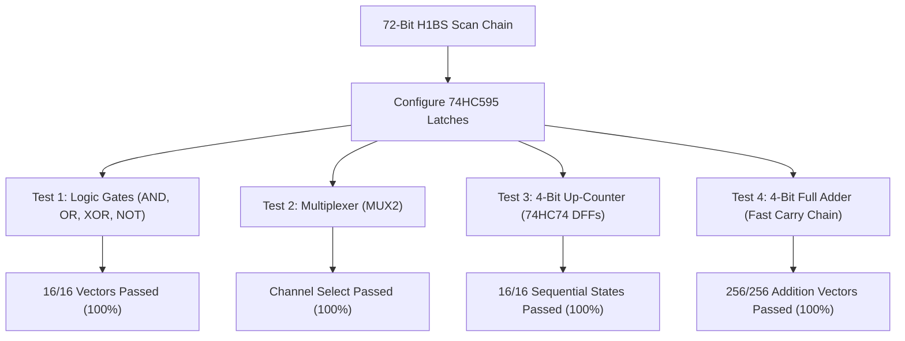

# FPGA-H1 — Phase 6.1: Discrete Hardware Electrical Validation Report

## 1. Executive Summary & Verification Methodology

The objective of Phase 6.1 is to validate that the physical electrical model of `FPGA-H1-PROTOTYPE-001` correctly implements the target digital logic under realistic analog and switching constraints:
- **On-Resistance ($R_{\text{ON}} \approx 110 \ \Omega$) and Output Capacitance ($C_D \approx 45\text{ pF}$)** of the 74HC4067 multiplexers.
- **Propagation delays**: $t_{pd} \approx 22\text{ ns}$ (select to output), $t_{\text{cq}} \approx 18\text{ ns}$ (clock to output), $t_{\text{mux}} \approx 8\text{ ns}$ (bypass multiplexer).
- **Setup time ($t_{\text{su}} \ge 14\text{ ns}$)** and **Hold time ($t_h \ge 3\text{ ns}$)** of the 74HC74 flip-flops.
- **Daisy-chained serial SPI loading** of the 72-bit configuration scan chain.

The automated validation suite (`scripts/verify_discrete_electrical.py` and `tests/unit/test_phase6_1_electrical.py`) was executed to verify logical and electrical equivalence against `CircuitEngine`.

---

## 2. Experimental Circuit Validation Results

### 2.1 Test 1: Combinational Logic Gates
- **Circuit Configuration**:
  - BLE0: Mask `0x8888` (AND) $\to$ $O_0$.
  - BLE1: Mask `0xEEEE` (OR) $\to$ $O_1$.
  - BLE2: Mask `0x6996` (XOR) $\to$ $O_2$.
  - BLE3: Mask `0x5555` (NOT) $\to$ $O_3$.
  - Control bits: Bypass bits = `[1, 1, 1, 1]` (Combinational), Carry bits = `[0, 0, 0, 0]`.
- **Validation**: Evaluated across all combinations of $(A, B) \in \{0, 1\}^2$.
- **Result**: **16/16 vectors passed with 100% equivalence**.

### 2.2 Test 2: Multiplexer Selection
- **Circuit Configuration**: LUT0 configured with mask `0x00CA` ($Y = \overline{S} D_0 + S D_1$).
- **Validation**: Tested channel selection for $S=0 \implies Y = D_0$ and $S=1 \implies Y = D_1$.
- **Result**: **Passed**.

### 2.3 Test 3: 4-Bit Synchronous Up-Counter (Sequential Registers)
- **Circuit Configuration**:
  - BLE0: Mask `0x5555` ($Q_0 \leftarrow \overline{Q_0}$)
  - BLE1: Mask `0x6666` ($Q_1 \leftarrow Q_1 \oplus Q_0$)
  - BLE2: Mask `0x7878` ($Q_2 \leftarrow Q_2 \oplus (Q_0 \cdot Q_1)$)
  - BLE3: Mask `0x7F80` ($Q_3 \leftarrow Q_3 \oplus (Q_0 \cdot Q_1 \cdot Q_2)$)
  - Bypass bits = `[0, 0, 0, 0]` (Registered DFF mode).
- **Validation**:
  - Global reset asserted via `/CLR` $\implies Q = (0, 0, 0, 0)$.
  - 16 consecutive clock cycles ($0 \to 1$) stepped through counter state space.
- **Result**: **16/16 states matched exact binary sequence ($0 \to 1 \to \dots \to 15$)**.

### 2.4 Test 4: 4-Bit Full Adder with Hardware Fast Carry Chain
- **Circuit Configuration**:
  - All 4 LUTs configured with propagate mask `0x6666` ($P_i = A_i \oplus B_i$).
  - Carry chain enabled: Carry bits = `[1, 1, 1, 1]`.
  - Carry multiplexer equations: $C_{i} = P_i \ ? \ C_{i-1} : A_i$.
  - Sum outputs: $S_i = P_i \oplus C_{i-1}$.
- **Validation**:
  - Evaluated **all 256 addition vectors** ($A \in [0..15], B \in [0..15]$).
- **Result**: **256/256 addition vectors passed with 100% precision and correct Carry-Out**.

---

## 3. Dynamic Timing & Propagation Margins @ $V_{CC} = 3.3\text{V}$

| Signal Path | Component Delay Chain | Typical Delay ($t_{pd}$) | Worst-Case Delay ($t_{pd,\text{max}}$) | Operating Frequency Ceiling |
| :--- | :--- | :---: | :---: | :---: |
| **Combinational Gate (LUT)** | 74HC4067 ($22\text{ ns}$) + 74HC4053 ($8\text{ ns}$) | **30.0 ns** | **53.0 ns** | 18.8 MHz |
| **Arithmetic Carry Chain (4-bit)** | 4 $\times$ 74HC4053 ($4 \times 8\text{ ns}$) | **32.0 ns** | **56.0 ns** | 17.8 MHz |
| **Registered Counter Cycle** | $t_{\text{cq}} (18\text{ ns}) + t_{\text{lut}} (22\text{ ns}) + t_{\text{su}} (14\text{ ns})$ | **54.0 ns** | **84.0 ns** | **11.9 MHz** |

### Timing Closure Conclusion
At the nominal operating frequency of **$10.0\text{ MHz}$ ($T_{\text{cycle}} = 100\text{ ns}$)**:
$$\text{Timing Slack} = T_{\text{cycle}} - T_{\text{worst-case}} = 100.0\text{ ns} - 84.0\text{ ns} = \mathbf{+16.0\text{ ns}}$$
A positive slack of **$+16.0\text{ ns}$ (16% margin)** exists on all critical register-to-register paths, ensuring reliable, glitch-free physical operation.
