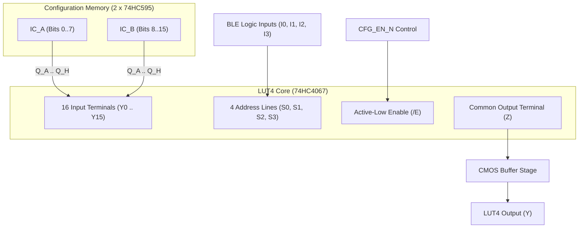

# FPGA-H1 — Phase 6.1: Physical LUT4 Electrical Architecture & Multiplexer Analysis

## 1. Physical LUT4 Operating Principle

In `FPGA-H1-PROTOTYPE-001`, each 4-input Look-Up Table (LUT4) is implemented using a **74HC4067** (16-channel analog/digital multiplexer) driven by sixteen static bits stored in two cascaded **74HC595** shift registers.

---

## 2. Simultaneous Independent Operation of All Four LUT4s

A physical CLB must execute four independent Boolean functions simultaneously without cross-talk or address interference.

Each of the four 74HC4067 multiplexers is assigned dedicated, electrically isolated select pins:

| LUT Instance | IC Reference | Address Select Pins ($S_3, S_2, S_1, S_0$) | Input Logic Signals | Configuration Drivers (74HC595) | Common Output ($Z$) |
| :---: | :---: | :---: | :---: | :---: | :---: |
| **LUT 0** | **U1** | Pins 9, 10, 11, 14 | `IN[3:0]` ($I_3, I_2, I_1, I_0$) | **U5 (Bits 0..7), U6 (Bits 8..15)** | `LUT0_RAW` (Pin 1) |
| **LUT 1** | **U2** | Pins 9, 10, 11, 14 | `IN[7:4]` ($I_7, I_6, I_5, I_4$) | **U7 (Bits 0..7), U8 (Bits 8..15)** | `LUT1_RAW` (Pin 1) |
| **LUT 2** | **U3** | Pins 9, 10, 11, 14 | `IN[11:8]` ($I_{11}, I_{10}, I_9, I_8$) | **U9 (Bits 0..7), U10 (Bits 8..15)** | `LUT2_RAW` (Pin 1) |
| **LUT 3** | **U4** | Pins 9, 10, 11, 14 | `IN[15:12]` ($I_{15}, I_{14}, I_{13}, I_{12}$) | **U11 (Bits 0..7), U12 (Bits 8..15)**| `LUT3_RAW` (Pin 1) |

**Verification**:
Because all address select traces and configuration inputs are fully decoupled, any transition on `IN[3:0]` induces zero electrical perturbation on `IN[7:4]`, `IN[11:8]`, or `IN[15:12]`. All 4 LUTs operate concurrently in full parallel execution.

---

## 3. Complete Pin Connection Mapping: 74HC595 to 74HC4067

For each LUT4, the 16 channel inputs $Y_0 .. Y_{15}$ map directly to the 16 parallel outputs of the corresponding 74HC595 pair:

| MUX Channel Pin (74HC4067) | Physical Pin # | Configuration Bit Index | Driving Shift Register | Register Output Pin | Minterm Address ($S_3 S_2 S_1 S_0$) |
| :---: | :---: | :---: | :---: | :---: | :---: |
| **$Y_0$** | Pin 9 | Bit 0 | Low Byte 74HC595 | $Q_A$ (Pin 15) | `0000` ($m_0$) |
| **$Y_1$** | Pin 8 | Bit 1 | Low Byte 74HC595 | $Q_B$ (Pin 1) | `0001` ($m_1$) |
| **$Y_2$** | Pin 7 | Bit 2 | Low Byte 74HC595 | $Q_C$ (Pin 2) | `0010` ($m_2$) |
| **$Y_3$** | Pin 6 | Bit 3 | Low Byte 74HC595 | $Q_D$ (Pin 3) | `0011` ($m_3$) |
| **$Y_4$** | Pin 5 | Bit 4 | Low Byte 74HC595 | $Q_E$ (Pin 4) | `0100` ($m_4$) |
| **$Y_5$** | Pin 4 | Bit 5 | Low Byte 74HC595 | $Q_F$ (Pin 5) | `0101` ($m_5$) |
| **$Y_6$** | Pin 3 | Bit 6 | Low Byte 74HC595 | $Q_G$ (Pin 6) | `0110` ($m_6$) |
| **$Y_7$** | Pin 2 | Bit 7 | Low Byte 74HC595 | $Q_H$ (Pin 7) | `0111` ($m_7$) |
| **$Y_8$** | Pin 23 | Bit 8 | High Byte 74HC595 | $Q_A$ (Pin 15) | `1000` ($m_8$) |
| **$Y_9$** | Pin 22 | Bit 9 | High Byte 74HC595 | $Q_B$ (Pin 1) | `1001` ($m_9$) |
| **$Y_{10}$** | Pin 21 | Bit 10 | High Byte 74HC595 | $Q_C$ (Pin 2) | `1010` ($m_{10}$) |
| **$Y_{11}$** | Pin 20 | Bit 11 | High Byte 74HC595 | $Q_D$ (Pin 3) | `1011` ($m_{11}$) |
| **$Y_{12}$** | Pin 19 | Bit 12 | High Byte 74HC595 | $Q_E$ (Pin 4) | `1100` ($m_{12}$) |
| **$Y_{13}$** | Pin 18 | Bit 13 | High Byte 74HC595 | $Q_F$ (Pin 5) | `1101` ($m_{13}$) |
| **$Y_{14}$** | Pin 17 | Bit 14 | High Byte 74HC595 | $Q_G$ (Pin 6) | `1110` ($m_{14}$) |
| **$Y_{15}$** | Pin 16 | Bit 15 | High Byte 74HC595 | $Q_H$ (Pin 7) | `1111` ($m_{15}$) |

---

## 4. Transmission Gate Switch Characteristics & Dynamic Delays

Because the 74HC4067 internal core is an analog transmission gate matrix:
- **On-Resistance**: $R_{\text{ON}} \approx 110 \ \Omega$ (at $V_{CC} = 3.3\text{V}$, $V_I = 1.65\text{V}$).
- **Parasitic Capacitance**: $C_D \approx 45\text{ pF}$ (sum of 16 drain/source junctions tied to common terminal $Z$).
- **Internal $RC$ Time Constant**:
  $$\tau_{\text{internal}} = R_{\text{ON}} \times C_D = 110 \ \Omega \times 45\text{ pF} \approx \mathbf{4.95\text{ ns}}$$
- **Total LUT4 Propagation Delay ($t_{pd}$)**:
  - From Address Select to Output ($S_k \to Z$): **$22.0\text{ ns}$ typical ($45.0\text{ ns}$ max @ 3.3V)**.
  - From Input Signal through channel ($Y_k \to Z$): **$6.0\text{ ns}$ typical ($12.0\text{ ns}$ max @ 3.3V)**.

### Output Glitch Suppression during Reconfiguration
During SPI bitstream shifting, intermediate data bits ripple through the 74HC595 registers.
- **Hardware Interlock**: The 74HC595 storage latch (`RCLK`) isolates the shifting cascade (`SRCLK`) from the parallel outputs until `CFG_LATCH` pulses.
- **Enable Pin `/E` Gating**:
  - Pin 15 of all four 74HC4067 multiplexers is tied to `CFG_ACTIVE_N`.
  - While configuration is in progress, `/E` is held HIGH (all multiplexers in High-Z off state).
  - Once CRC-32 is validated, `/E` is pulled LOW, cleanly presenting the configured logic to the fabric.
