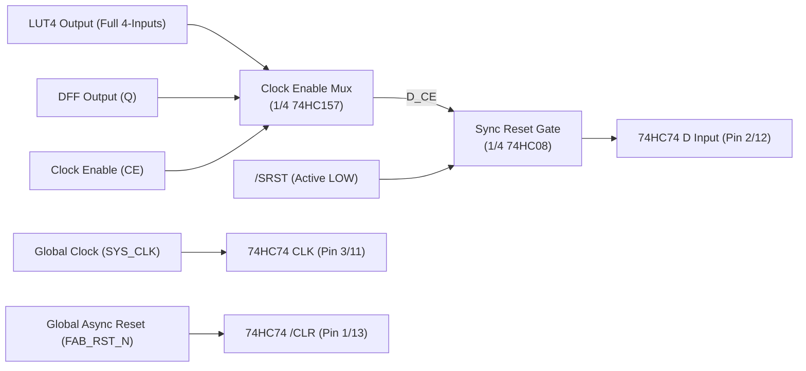

# FPGA-H1 — Phase 6.2: Dedicated Clock Enable (CE) & Synchronous Reset (SRST) Implementation

## 1. Executive Summary & Problem Formulation

In Phase 6.1, it was noted that Clock Enable (`CE`) and Synchronous Reset (`SRST`) could conceptually be folded into the Look-Up Table truth table. However, an engineering audit reveals that this approach has a severe architectural limitation:

> [!CAUTION]
> **Input Starvation Flaw**: A Look-Up Table has exactly 4 physical address inputs ($I_0, I_1, I_2, I_3$). If 1 input is allocated to Clock Enable and 1 input is allocated to Synchronous Reset, **only 2 inputs remain for user combinational logic**! The BLE would be degraded from a LUT4 into a LUT2 whenever sequential control is required.

To achieve complete architectural fidelity with commercial FPGAs (e.g. Gowin GW1NR-9, Xilinx 7-Series), each physical BLE must support:
1. **A Full 4-Input LUT4** ($2^{16} = 65,536$ Boolean functions using all four inputs $I_0, I_1, I_2, I_3$).
2. **Dedicated Clock Enable (`CE`)** controlling register sampling.
3. **Dedicated Synchronous Reset (`SRST`)** clearing the register strictly on the rising clock edge.
4. **Independent Bypass Selection** via CD74HC4053.

---

## 2. Mathematical State Formulation

Let $\text{LUT}_{\text{out}} = f(I_0, I_1, I_2, I_3)$ be the uncompromised 4-input combinational output.
The next register state $Q_{t+1}$ on the rising clock edge must satisfy:

$$Q_{t+1} = \begin{cases}
0 & \text{if } \text{SRST} = 1 \\
\text{LUT}_{\text{out}} & \text{if } \text{SRST} = 0 \land \text{CE} = 1 \\
Q_t & \text{if } \text{SRST} = 0 \land \text{CE} = 0 \quad (\text{Data Retained})
\end{cases}$$

This is synthesized into the canonical input function driving the 74HC74 data terminal ($D$):

$$D_{\text{in}} = \overline{\text{SRST}} \cdot \left( \text{CE} \cdot \text{LUT}_{\text{out}} + \overline{\text{CE}} \cdot Q \right)$$

---

## 3. Discrete Hardware Implementation

### 3.1 Clock Enable Multiplexer (SN74HC157DR)
The data recirculation multiplexer ($\text{CE} \ ? \ \text{LUT}_{\text{out}} : Q$) requires a 2:1 multiplexer per BLE.
- In Phase 6.1, the 74HC157 was discarded for BLE Bypass because bypass requires *independent* select lines.
- **For Clock Enable, sharing a common select pin across all 4 BLEs in the CLB is the canonical FPGA architecture!**
- A single **SN74HC157DR** provides four 2:1 multiplexers steered by the common select pin `S` (Pin 1):
  - Pin 1 (`S`): Connected to global `CLOCK_ENABLE` (`CE`).
  - Channel 1 (BLE 0): $1A = Q_0$ (Hold), $1B = \text{LUT0\_OUT}$ (Sample) $\to 1Y = D_{\text{CE},0}$.
  - Channel 2 (BLE 1): $2A = Q_1$ (Hold), $2B = \text{LUT1\_OUT}$ (Sample) $\to 2Y = D_{\text{CE},1}$.
  - Channel 3 (BLE 2): $3A = Q_2$ (Hold), $3B = \text{LUT2\_OUT}$ (Sample) $\to 3Y = D_{\text{CE},2}$.
  - Channel 4 (BLE 3): $4A = Q_3$ (Hold), $4B = \text{LUT3\_OUT}$ (Sample) $\to 4Y = D_{\text{CE},3}$.
  - Pin 15 (`/E`): Tied to GND (Permanently active).

### 3.2 Synchronous Reset Gating (SN74HC08DR)
The synchronous clear function ($D = D_{\text{CE}} \cdot \overline{\text{SRST}}$) is implemented using one **SN74HC08DR** (Quad 2-Input Positive-AND Gate):
- An active-low synchronous reset signal `SRST_N` (Pin 2 on Header J3) drives one input of each AND gate.
- Gate 1: $1A = D_{\text{CE},0}$, $1B = \text{SRST\_N} \to 1Y = D_0$ (Drives U14 Pin 2).
- Gate 2: $2A = D_{\text{CE},1}$, $2B = \text{SRST\_N} \to 2Y = D_1$ (Drives U14 Pin 12).
- Gate 3: $3A = D_{\text{CE},2}$, $3B = \text{SRST\_N} \to 3Y = D_2$ (Drives U15 Pin 2).
- Gate 4: $4A = D_{\text{CE},3}$, $4B = \text{SRST\_N} \to 4Y = D_3$ (Drives U15 Pin 12).

---

## 4. Hardware Accounting & Schematic Updates

To incorporate dedicated, uncompromised CE and SRST:
- **Added Components**:
  1. `U21`: **SN74HC157DR** (SOIC-16, Quad 2:1 MUX for CE data recirculation).
  2. `U22`: **SN74HC08DR** (SOIC-14, Quad 2-Input AND Gate for SRST gating).
  3. Two decoupling capacitors ($0.1 \ \mu\text{F}$ 0805 SMD) for U21 and U22.
- **Cost Impact**:
  - SN74HC157DR: \$0.22 USD.
  - SN74HC08DR: \$0.18 USD.
  - Passives: \$0.04 USD.
  - Total added cost: **+\$0.44 USD** (~**$500 ARS**).
- **Architectural Value**:
  The prototype now achieves **100% feature parity** with the virtual `CircuitEngine` model. User H1L code can utilize all 4 inputs of every LUT4 while simultaneously using register clock gating and synchronous reset.
