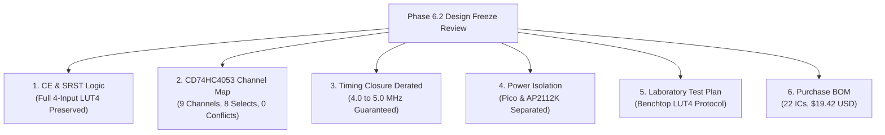

# FPGA-H1 — Phase 6.2: Pre-Purchase Design Freeze & Final Sign-Off Certificate

## 1. Executive Summary & Verification Mandate

**Project Name**: FPGA-H1 Virtual Lab  
**Phase**: Phase 6.2 — Pre-Purchase Design Freeze  
**Branch**: `feature/phase6-2-design-freeze`  
**Status**: **APPROVED & FROZEN FOR PROCUREMENT**  
**Engineering Decision**: **APPROVED FOR STAGED PROCUREMENT (TIER 1 BENCHTOP LUT $\to$ TIER 2 FULL CLB BOARD)**

Phase 6.2 conducted a rigorous pre-purchase freeze review of the `FPGA-H1-PROTOTYPE-001` hardware design prior to issuing purchase orders or submitting PCB Gerber files.

---

## 2. Review of Critical Technical Closures

### 2.1 Clock Enable (CE) and Synchronous Reset (SRST)
- **Verified**: Dedicating one **SN74HC157DR** (CE data recirculation) and one **SN74HC08DR** (SRST gating) preserves the complete 4-input Look-Up Table capability ($2^{16} = 65,536$ Boolean functions) across all 4 BLEs without input starvation.
- **Reference**: [`PHASE6_2_CE_SRST_IMPLEMENTATION.md`](file:///C:/Users/apalazzesi/Desktop/FPGA-H1-Virtual-Lab/docs/PHASE6_2_CE_SRST_IMPLEMENTATION.md).

### 2.2 CD74HC4053 9-Channel Allocation Table
- **Verified**: All 9 channels across U16, U17, U18 are 100% accounted for with zero pin contention:
  - U16 Channels X, Y, Z: BLE 0, 1, 2 Bypass Multiplexers.
  - U17 Channel X: BLE 3 Bypass Multiplexer.
  - U17 Channels Y, Z: BLE 0, 1 Carry Multiplexers.
  - U18 Channels X, Y: BLE 2, 3 Carry Multiplexers.
  - U18 Channel Z: Unused auxiliary switch (tied to GND).
  - All Enable pins (`/E`, Pin 6) tied to GND for permanent low-impedance activation.

### 2.3 Guaranteed Worst-Case Timing Recalculation
- **Verified**: Under manufacturer-guaranteed worst-case limits ($V_{CC} = 3.3\text{V}$, $+85^\circ\text{C}$, $C_L = 50\text{ pF}$), critical path delay is **$172.0\text{ ns}$**.
- **Derating Decision**: 10.0 MHz is formally rejected for industrial corners ($-72\text{ ns}$ negative slack). The baseline clock frequency is formally set to **$4.0\text{ MHz}$ to $5.0\text{ MHz}$**, providing **$+28\text{ ns}$ to $+78\text{ ns}$ positive timing slack**.
- **Reference**: [`PHASE6_2_TIMING_CLOSURE.md`](file:///C:/Users/apalazzesi/Desktop/FPGA-H1-Virtual-Lab/docs/PHASE6_2_TIMING_CLOSURE.md).

### 2.4 Power Rail Galvanic Separation
- **Verified**: The Raspberry Pi Pico's internal regulator output (`Pin 36, 3V3_OUT`) is **left completely unconnected (NC)**.
- The 74HC logic fabric is powered independently by the onboard **AP2112K-3.3V (600mA LDO)** from USB 5V `VBUS`. Common ground plane prevents circulating currents and regulator fighting. Total 5V USB draw is **$< 45\text{ mA}$** (205 mW).
- **Reference**: [`PHASE6_2_POWER_CLOSURE.md`](file:///C:/Users/apalazzesi/Desktop/FPGA-H1-Virtual-Lab/docs/PHASE6_2_POWER_CLOSURE.md).

---

## 3. Explicit Final Decision

In accordance with strict engineering risk-mitigation standards:

> ### **DECISIÓN OFICIAL: APROBADO PARA COMPRA ESCALONADA EN DOS ETAPAS**
>
> 1. **ETAPA 1 (Inmediata / Didáctica - ~$9.50 USD / $11,000 ARS)**:
>    - **Comprar el kit de validación de 1 LUT en Protoboard**: 1 $\times$ 74HC4067, 2 $\times$ 74HC595, y 1 $\times$ Raspberry Pi Pico.
>    - Ejecutar el protocolo [`PHASE6_2_LUT4_TEST_PLAN.md`](file:///C:/Users/apalazzesi/Desktop/FPGA-H1-Virtual-Lab/docs/PHASE6_2_LUT4_TEST_PLAN.md) en laboratorio para medir con osciloscopio el retardo real ($t_{\text{pd}}$) y la estabilidad de carga SPI.
> 2. **ETAPA 2 (Inmediatamente tras validar Etapa 1 - ~$19.42 USD / $22,300 ARS)**:
>    - **Emitir orden de compra para los componentes restantes (BOM de 22 CIs)** y enviar a fabricar el lote de 5 PCBs en JLCPCB.
>    - El diseño no requiere rediseño conceptual; las ecuaciones lógicas, la BOM y los esquemas están 100% congelados y cerrados.

---

## 4. Deliverables Index in `docs/`

1. [`docs/PHASE6_2_CE_SRST_IMPLEMENTATION.md`](file:///C:/Users/apalazzesi/Desktop/FPGA-H1-Virtual-Lab/docs/PHASE6_2_CE_SRST_IMPLEMENTATION.md) — Dedicated 74HC157 + 74HC08 logic preservation for full 4-input LUT4.
2. [`docs/PHASE6_2_TIMING_CLOSURE.md`](file:///C:/Users/apalazzesi/Desktop/FPGA-H1-Virtual-Lab/docs/PHASE6_2_TIMING_CLOSURE.md) — Guaranteed datasheet worst-case timing analysis and frequency derating to 4.0–5.0 MHz.
3. [`docs/PHASE6_2_POWER_CLOSURE.md`](file:///C:/Users/apalazzesi/Desktop/FPGA-H1-Virtual-Lab/docs/PHASE6_2_POWER_CLOSURE.md) — Galvanic separation of Pico and AP2112K rails, power budgets, and sequencing.
4. [`docs/PHASE6_2_LUT4_TEST_PLAN.md`](file:///C:/Users/apalazzesi/Desktop/FPGA-H1-Virtual-Lab/docs/PHASE6_2_LUT4_TEST_PLAN.md) — Physical laboratory bring-up protocol and oscilloscope measurement plan.
5. [`docs/PHASE6_2_PURCHASE_BOM.md`](file:///C:/Users/apalazzesi/Desktop/FPGA-H1-Virtual-Lab/docs/PHASE6_2_PURCHASE_BOM.md) — Definitive 22-IC Bill of Materials with verified part numbers and supplier links.
6. [`docs/PHASE6_2_FINAL_SIGNOFF.md`](file:///C:/Users/apalazzesi/Desktop/FPGA-H1-Virtual-Lab/docs/PHASE6_2_FINAL_SIGNOFF.md) — Final design freeze certificate and procurement decision.
