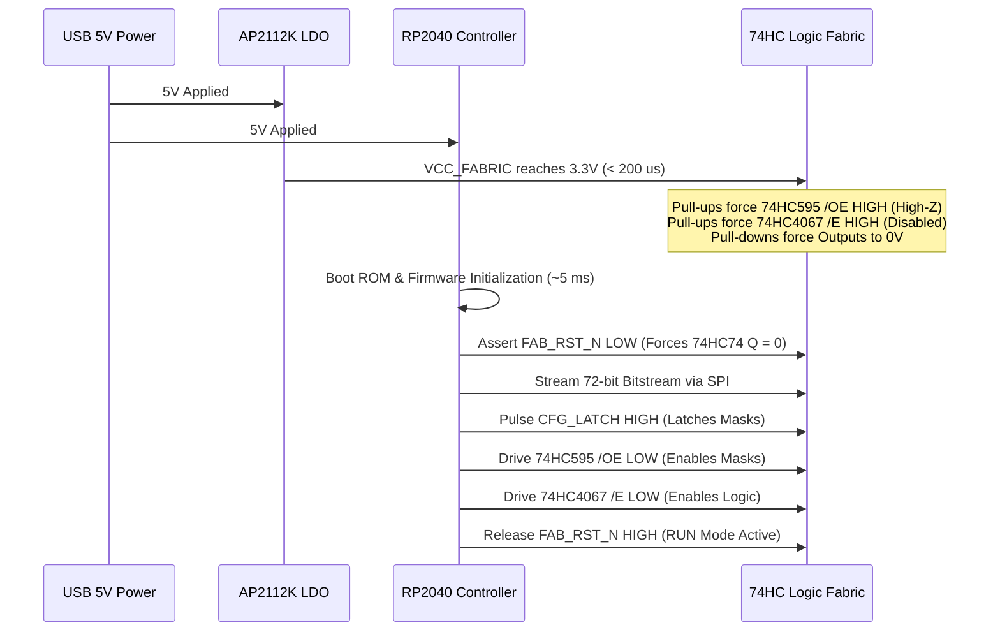

# FPGA-H1 — Phase 6.2: Power Distribution, Voltage Regulation & Power-On Sequencing

## 1. Executive Summary & Electrical Isolation Mandate

During Phase 6.1, an on-board AP2112K-3.3V LDO regulator was proposed alongside the Raspberry Pi Pico. An electrical audit of the power rail topology revealed a critical risk:

> [!CAUTION]
> **Regulator Paralleling Danger**: Connecting the output of the Raspberry Pi Pico's internal buck-boost regulator (`Pin 36, 3V3_OUT`) in parallel with the external AP2112K LDO regulator creates a destructive circulating current loop. Even a 20 mV voltage offset between the two regulators will cause the higher-voltage regulator to source heavy current into the lower-voltage regulator, inducing thermal shutdown or regulator damage.

### Definitive Power Architecture Decision:
- **Common Source**: Single 5V supply derived from USB `VBUS`.
- **Galvanic Rail Separation**:
  - The Raspberry Pi Pico powers itself internally from `VBUS` through its onboard RT6150B regulator.
  - The discrete logic fabric is powered independently through the on-board **AP2112K-3.3V (600mA LDO)** from `VBUS`.
  - **Pico `Pin 36 (3V3_OUT)` is LEFT COMPLETELY UNCONNECTED (NC)**.
  - Both rails share a solid, common **Ground Plane (GND)**, enabling direct 3.3V LVCMOS signal transmission with zero level translators and zero regulator conflict.

```mermaid
flowchart TD
    USB["USB 5V (VBUS)"] --> PICO_VBUS["RP2040 Pico Pin 40 (VBUS)"]
    USB --> LDO_IN["AP2112K-3.3 Pin 1/3 (VIN / EN)"]
    
    subgraph PicoSubsystem ["RP2040 Controller Domain"]
        PICO_VBUS --> RT6150["Onboard RT6150B Regulator"]
        RT6150 --> PICO_CORE["RP2040 Core & GPIOs (3.3V)"]
        RT6150 -.-> PICO_PIN36["Pin 36 (3V3_OUT): UNCONNECTED (NC)"]
    end
    
    subgraph FabricSubsystem ["FPGA-H1 Logic Fabric Domain"]
        LDO_IN --> LDO_OUT["AP2112K Output (3.3V @ 600mA)"]
        LDO_OUT --> VCC_FABRIC["VCC_FABRIC Power Plane (+3.3V)"]
        VCC_FABRIC --> IC_ARRAY["21 x Discrete 74HC ICs"]
    end
    
    PICO_CORE <==|3.3V CMOS Signals (SPI, Clocks, Resets)|==> IC_ARRAY
    PicoSubsystem ===|Common System Ground (GND)|=== FabricSubsystem
```

---

## 2. Quantitative Current & Power Consumption Budget

Operating at the derated target frequency of **$5.0\text{ MHz}$**:

| Subsystem / Load Group | Quantity | Static Current ($I_{\text{static}}$) | Dynamic Current @ 5 MHz ($\alpha=0.15$) | Total Current @ 3.3V |
| :--- | :---: | :---: | :---: | :---: |
| **RP2040 Pico Module (133 MHz)**| 1 | 18.0 mA | 8.0 mA | **26.0 mA** |
| **74HC4067 (4 x LUT4)** | 4 | 0.03 mA | 2.2 mA | **2.23 mA** |
| **74HC595 (9 x Config Latches)**| 9 | 0.07 mA | 0.0 mA (Quiescent during run) | **0.07 mA** |
| **74HC74 (2 x Dual DFF)** | 2 | 0.01 mA | 1.8 mA | **1.81 mA** |
| **74HC4053 (3 x Bypass/Carry)** | 3 | 0.02 mA | 1.5 mA | **1.52 mA** |
| **74HC157 (1 x CE Mux)** | 1 | 0.01 mA | 0.8 mA | **0.81 mA** |
| **74HC08 (1 x SRST AND)** | 1 | 0.01 mA | 0.5 mA | **0.51 mA** |
| **Status LEDs (4 x Output LEDs)**| 4 | — | 2.0 mA each | **8.00 mA** |
| **Total 3.3V Current Demand** | — | **18.15 mA** | **14.80 mA** | **40.95 mA** |

### USB 5V Total Power Budget:
$$P_{\text{total, USB}} = 5.0\text{V} \times 40.95\text{ mA} \approx \mathbf{0.205\text{ W}} \quad (205\text{ mW})$$
- Maximum USB 5V current draw is **$< 45\text{ mA}$**, representing less than **9%** of a standard USB 2.0 port's 500 mA capability.

---

## 3. High-Frequency Decoupling Strategy

To suppress transient switching noise and voltage droop during synchronous clock edges:

1. **Local High-Frequency Decoupling**:
   - Exactly **twenty-one (21) $0.1 \ \mu\text{F}$ X7R ceramic capacitors (0805 SMD)**.
   - One capacitor placed directly adjacent to Pin $V_{CC}$ and Pin GND on every IC ($< 3\text{ mm}$ trace distance).
2. **Bulk Stabilization**:
   - One **$10 \ \mu\text{F}$ 16V Tantalum capacitor** at the 5V USB entrance.
   - One **$10 \ \mu\text{F}$ 16V Tantalum capacitor** at the AP2112K 3.3V output terminal ($ESR < 0.5 \ \Omega$).
3. **Ground Plane Layout**:
   - The entire bottom copper layer (Layer 2) is dedicated as an uninterrupted solid ground plane (GND), minimizing parasitic trace inductance.

---

## 4. Power-On Sequencing & Glitch-Free Reset Protocol

To prevent spurious glitches, pin contention, or floating states during power-up:



1. **Phase 1: Cold Boot ($t = 0 \to 5\text{ ms}$)**:
   - Resistor pull-up $R_{21}$ (10k) on 74HC595 `/OE` (Pin 13) keeps all 72 shift register outputs in high-impedance.
   - Resistor pull-up $R_{22}$ (10k) on 74HC4067 `/E` (Pin 15) keeps all four multiplexer outputs in high-impedance.
   - Four 100k pull-down resistors on `OUT[3:0]` hold all primary outputs strictly at **$0.0\text{V}$**.
2. **Phase 2: Configuration Streaming ($t = 5 \to 6\text{ ms}$)**:
   - The RP2040 asserts `FAB_RST_N` LOW, resetting all flip-flops.
   - The 72 bits stream over SPI at 10 MHz ($t_{\text{load}} \approx 7.2 \ \mu\text{s}$).
3. **Phase 3: Safe Enable ($t > 6\text{ ms}$)**:
   - `CFG_LATCH` pulses high, latching the verified configuration.
   - The RP2040 asserts `/OE` LOW and `/E` LOW. The fabric begins real-time execution cleanly with zero power-on glitches.
