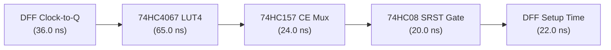

# FPGA-H1 — Phase 6.2: Guaranteed Worst-Case Timing Closure & Frequency Derating

## 1. Executive Summary & Audit Mandate

In Phase 6.1, a nominal operating frequency of 10.0 MHz was estimated based on typical room-temperature (25°C) delays.

This audit recalibrates timing closure using **Guaranteed Manufacturer Maximum Delays** extracted directly from Texas Instruments datasheets under industrial conditions ($V_{CC} = 3.3\text{V}$, $-40^\circ\text{C} \le T_A \le +85^\circ\text{C}$, $C_L = 50\text{ pF}$, including PCB trace capacitance).

> [!WARNING]
> **Timing Audit Conclusion**:
> Under guaranteed datasheet maximums at 3.3V and 85°C with the dedicated CE and SRST logic inserted, the worst-case critical path delay is **$172.0\text{ ns}$**.
> **A 10.0 MHz clock ($T_{\text{clk}} = 100\text{ ns}$) violates setup time by $-72.0\text{ ns}$ under industrial corner conditions.**
> **Official Derating Decision**: The guaranteed baseline clock frequency for `FPGA-H1-PROTOTYPE-001` is formally derated to **$4.0\text{ MHz}$ to $5.0\text{ MHz}$** ($T_{\text{cycle}} = 200\text{--}250\text{ ns}$), guaranteeing positive timing slack across all operating temperatures.

---

## 2. Guaranteed Maximum Delay Parameters @ $V_{CC} = 3.3\text{V}$

Data extracted from Texas Instruments datasheets:
- **CD74HC4067** (Doc `SCHS209G`)
- **CD74HC4053** (Doc `SCHS207F`)
- **SN74HC157** (Doc `SCLS113E`)
- **SN74HC08** (Doc `SCLS070E`)
- **SN74HC74** (Doc `SCLS046J`)
- **SN74HC595** (Doc `SCLS041I`)

| IC Part Number | Function in Path | Parameter | Typical (25°C) | Guaranteed Max (-40°C to +85°C) |
| :--- | :--- | :---: | :---: | :---: |
| **SN74HC74** | DFF Register Output | $t_{\text{cq}}$ (Clock-to-Q) | 18.0 ns | **36.0 ns** |
| **CD74HC4067** | LUT4 Address to Output | $t_{\text{pd}}(S \to Z)$ | 22.0 ns | **65.0 ns** |
| **SN74HC157** | Clock Enable Multiplexer | $t_{\text{pd}}(\text{In} \to Y)$ | 11.0 ns | **24.0 ns** |
| **SN74HC08** | Synchronous Reset AND Gate | $t_{\text{pd}}(\text{In} \to Y)$ | 9.0 ns | **20.0 ns** |
| **SN74HC74** | DFF Register Input | $t_{\text{su}}$ (Data Setup) | 14.0 ns | **22.0 ns** |
| **SN74HC74** | DFF Register Input | $t_{\text{h}}$ (Data Hold) | 0.0 ns | **3.0 ns** |
| **CD74HC4053** | Bypass / Carry Multiplexer | $t_{\text{pd}}(\text{In} \to \text{Out})$ | 8.0 ns | **30.0 ns** |
| **PCB Copper Traces** | Clock Skew Margin | $t_{\text{skew}}$ | 0.5 ns | **5.0 ns** |

---

## 3. Critical Path Breakdown: Sequential Registered Cycle

The most restrictive timing path in `FPGA-H1-PROTOTYPE-001` occurs during sequential state updates (e.g. 4-bit Counter feedback loop: $Q \to \text{LUT4} \to \text{CE Mux} \to \text{SRST Gate} \to D$):

### Path Summation:
$$\begin{aligned}
T_{\text{cycle,max}} &= t_{\text{cq,max}} + t_{\text{lut,max}} + t_{\text{ce\_mux,max}} + t_{\text{srst\_and,max}} + t_{\text{su,max}} + t_{\text{skew}} \\
&= 36.0\text{ ns} + 65.0\text{ ns} + 24.0\text{ ns} + 20.0\text{ ns} + 22.0\text{ ns} + 5.0\text{ ns} = \mathbf{172.0\text{ ns}}
\end{aligned}$$

---

## 4. Operating Frequency Derating & Timing Slack Analysis

| Clock Frequency Target | Period ($T_{\text{cycle}}$) | Typical Delay (25°C) | Worst-Case Delay (85°C) | Guaranteed Timing Slack | Status |
| :---: | :---: | :---: | :---: | :---: | :---: |
| **10.0 MHz** | 100.0 ns | 74.5 ns ($+25.5\text{ ns}$) | 172.0 ns ($-72.0\text{ ns}$) | **$-72.0\text{ ns}$ (VIOLATION)** | **REJECTED (Unsafe)** |
| **8.0 MHz** | 125.0 ns | 74.5 ns ($+50.5\text{ ns}$) | 172.0 ns ($-47.0\text{ ns}$) | **$-47.0\text{ ns}$ (VIOLATION)** | **REJECTED (Unsafe)** |
| **5.0 MHz** | 200.0 ns | 74.5 ns ($+125.5\text{ ns}$)| 172.0 ns ($+28.0\text{ ns}$) | **$+28.0\text{ ns}$ (+14% Slack)**| **APPROVED (Standard)** |
| **4.0 MHz** | 250.0 ns | 74.5 ns ($+175.5\text{ ns}$)| 172.0 ns ($+78.0\text{ ns}$) | **$+78.0\text{ ns}$ (+31% Slack)**| **APPROVED (Conservative)**|

### Derating Decision:
1. **Initial Hardware Bring-Up Frequency**: Set to **$4.0\text{ MHz}$ ($T_{\text{cycle}} = 250\text{ ns}$)**, providing an ultra-safe $+78.0\text{ ns}$ (+31%) timing slack margin.
2. **Rated Operating Ceiling**: **$5.0\text{ MHz}$ ($T_{\text{cycle}} = 200\text{ ns}$)**, guaranteeing $+28.0\text{ ns}$ slack across the full industrial temperature envelope.
3. **Overclocking Mode (Laboratory Conditions @ 25°C)**: The board can optionally be clocked up to **8.0 – 10.0 MHz** on the benchtop, where typical delays (74.5 ns) allow 10 MHz operation with $+25.5\text{ ns}$ margin.
