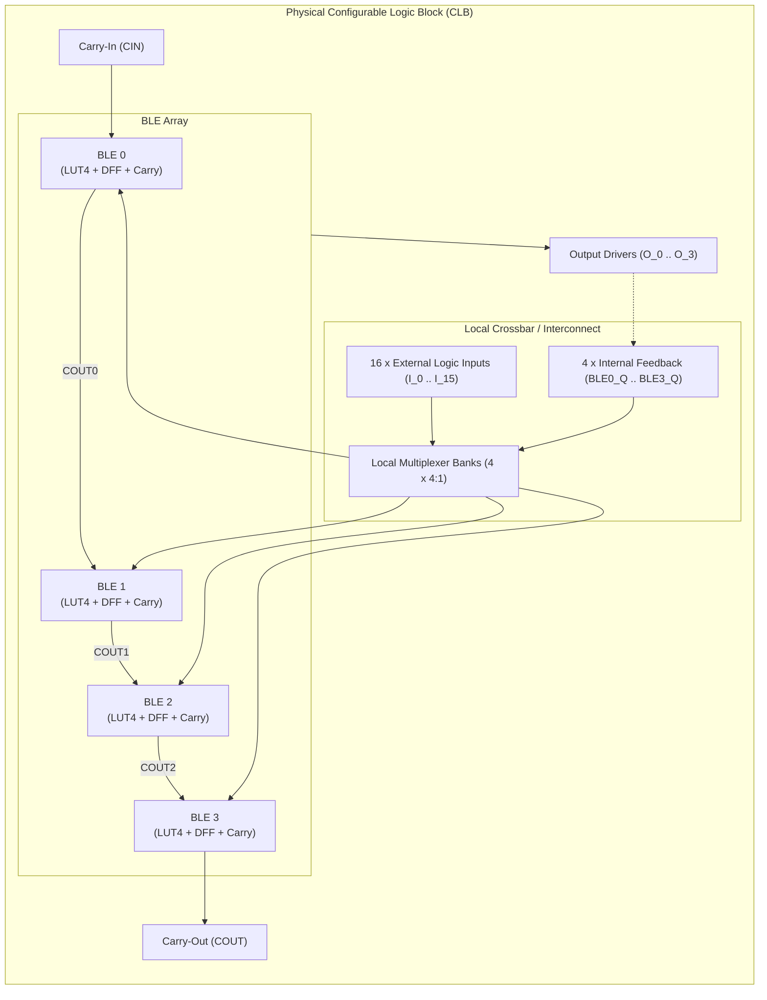
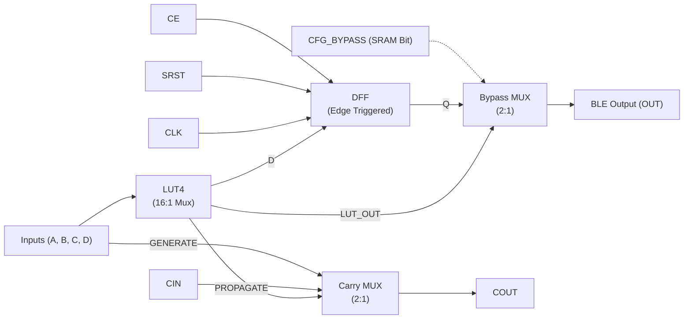

# FPGA-H1 — Phase 6: Physical CLB Architecture & BLE Integration

## 1. Configurable Logic Block (CLB) Overview

The **Configurable Logic Block (CLB)** is the central programmable tile of the FPGA-H1 architecture. Each physical CLB integrates:
- **Four Basic Logic Elements (BLE0, BLE1, BLE2, BLE3)**.
- **Dedicated Fast Carry Chain** linking BLE0 through BLE3.
- **Internal Local Interconnect** providing high-speed feedback from BLE outputs to BLE inputs without consuming external channel routing tracks.
- **Clock, Reset, and Enable Conditioning Network**.
- **Configuration Shift Chain** for programming LUT masks and multiplexer bypass bits.

---

## 2. Basic Logic Element (BLE) Physical Schematic

Each BLE contains one LUT4, a fast carry multiplexer, a D-type flip-flop (DFF), and an output bypass multiplexer.

### Discrete Implementation of BLE Components
1. **Look-Up Table (LUT4)**: 1 $\times$ 74HC4067 (16:1 MUX) + 2 $\times$ 74HC595 (16-bit configuration shift register).
2. **D-Type Flip-Flop (DFF)**: 1/2 of a **74HC74** (Dual Positive-Edge-Triggered D-Type Flip-Flop with Set and Reset).
   - Clock input driven by global `CLK`.
   - Data input $D$ driven by LUT4 output $Y$.
   - Output $Q$ driven to bypass MUX.
3. **Bypass Multiplexer**: 1/4 of a **74HC157** (Quad 2:1 Data Selector/Multiplexer).
   - Input $A$: Direct LUT4 output ($Y$).
   - Input $B$: Registered flip-flop output ($Q$).
   - Select $S$: Driven by a configuration latch bit (`CFG_BYPASS`).
   - Output: BLE Output.
4. **Carry Multiplexer**: 1/4 of a 74HC157 configured as a 2:1 multiplexer:
   $$C_{\text{out}} = \text{LUT}_{\text{out}} \ ? \ C_{\text{in}} : I_0$$
   When $\text{LUT}_{\text{out}} = 1$, carry propagates ($C_{\text{out}} = C_{\text{in}}$). When $\text{LUT}_{\text{out}} = 0$, carry generates ($C_{\text{out}} = I_0$).

---

## 3. Physical CLB Signal Specification & Pinout

The complete CLB block exposes 32 physical digital pins:

| Pin Group | Pin Name | Direction | Active Level | Description |
| :--- | :--- | :---: | :---: | :--- |
| **Primary Logic Inputs** | `IN[15:0]` | Input | High (3.3V) | 16 general-purpose inputs (4 inputs per BLE: $A, B, C, D$) |
| **Primary Logic Outputs**| `OUT[3:0]` | Output | High (3.3V) | 4 combinational/registered BLE outputs ($O_0, O_1, O_2, O_3$) |
| **Arithmetic Carry** | `CIN` | Input | High | Carry-in to BLE0 fast arithmetic chain |
| **Arithmetic Carry** | `COUT` | Output | High | Carry-out from BLE3 fast arithmetic chain |
| **Clock & Control** | `CLK` | Input | Rising Edge | Low-skew global synchronous clock |
| **Clock & Control** | `SRST` | Input | Active High | Synchronous reset to all 4 DFFs |
| **Clock & Control** | `CE` | Input | Active High | Clock enable gate to all 4 DFFs |
| **Configuration Bus** | `CFG_MOSI` | Input | High | Serial configuration data in (SPI) |
| **Configuration Bus** | `CFG_MISO` | Output | High | Serial configuration data daisy-chain out (SPI) |
| **Configuration Bus** | `CFG_SCK` | Input | Rising Edge | Configuration shift clock |
| **Configuration Bus** | `CFG_LATCH`| Input | Rising Edge | Configuration register update pulse |
| **Power & Ground** | `VCC` | Power | +3.3V / +5.0V| Main digital supply |
| **Power & Ground** | `GND` | Ground | 0V | System reference ground |

---

## 4. Discrete Component Inventory for 1 Full Physical CLB

To construct 1 complete physical CLB (`FPGA-H1-PROTOTYPE-001`) using standard 74HC components:

| Component Type | Part Number | Package | Qty per CLB | Purpose / Function |
| :--- | :--- | :---: | :---: | :--- |
| **16:1 Multiplexer** | **74HC4067** | TSSOP-24 / DIP-24 | 4 | 4 $\times$ LUT4 logic evaluation trees |
| **8-bit Shift Register** | **74HC595** | SOIC-16 / DIP-16 | 8 | 4 $\times$ 16-bit LUT4 configuration masks (64 bits) |
| **Dual D Flip-Flop** | **74HC74** | SOIC-14 / DIP-14 | 2 | 4 $\times$ DFF sequential state registers |
| **Quad 2:1 Multiplexer** | **74HC157** | SOIC-16 / DIP-16 | 2 | 4 $\times$ Bypass MUX + 4 $\times$ Carry MUX |
| **Bypass Config Register**| **74HC595** | SOIC-16 / DIP-16 | 1 | Stores 4 bypass bits + 4 local interconnect bits |
| **Bypass Capacitors** | **0.1 $\mu\text{F}$ X7R** | 0805 SMD | 17 | High-frequency supply decoupling at each IC |
| **Total Active ICs** | — | — | **17 ICs** | Complete 1 CLB (4 LUT4 + 4 DFF) |

This inventory provides the exact physical foundation for the minimum physical prototype described in Section 10.
