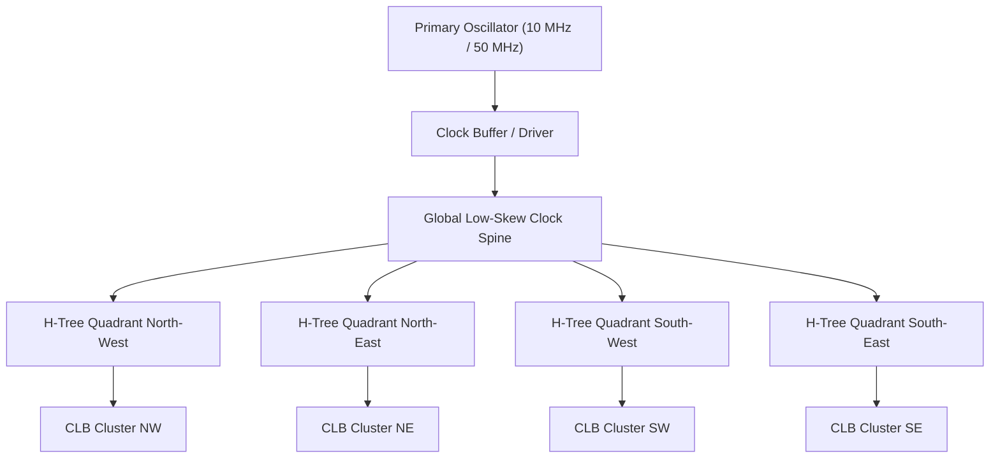

# FPGA-H1 — Phase 6: Clock Distribution & Physical Timing Analysis

## 1. Physical Clock Network Architecture

In synchronous digital architectures, clock skew ($\Delta t_{\text{skew}} = t_{\text{clk,max}} - t_{\text{clk,min}}$) can induce race conditions, hold-time violations ($t_{\text{hold}} > t_{\text{cq}} + t_{\text{wire,min}} - \Delta t_{\text{skew}}$), and false state transitions.

### 1.1 Silicon Implementation (Balanced H-Tree)
- A recursive binary **H-Tree** distributes the global clock across the $47 \times 47$ tile matrix.
- Path lengths from the central root buffer to every CLB leaf cell are geometrically symmetric, bounding maximum clock skew to **$< 85 \text{ ps}$** in SkyWater 130nm.

### 1.2 Discrete Prototype Implementation (Star Topology)
- On the physical PCB (`FPGA-H1-PROTOTYPE-001` / `PROTOTYPE-004`), an H-tree is impractical due to trace widths.
- A **Star Topology** using a low-skew clock buffer (e.g. **74LVC1G125** or dedicated 1:4 clock driver **PI6C49X0204**) delivers matched trace lengths ($L \pm 1\text{ mm}$), holding skew to **$< 150 \text{ ps}$**.

---

## 2. Dynamic Timing Model & Timing Closure Equations

The maximum clock frequency $f_{\text{max}}$ of any synchronous path between flip-flop $FF_1$ and $FF_2$ is governed by:

$$T_{\text{cycle}} \ge t_{\text{cq}} + t_{\text{comb}} + t_{\text{wire}} + t_{\text{su}} + t_{\text{skew}} + t_{\text{jitter}}$$
$$f_{\text{max}} = \frac{1}{T_{\text{cycle}}}$$

Where:
- $t_{\text{cq}}$: Clock-to-Q output propagation delay.
- $t_{\text{comb}}$: Combinational logic delay through LUT4s and bypass multiplexers.
- $t_{\text{wire}}$: Routing delay across Connection Boxes, Switch Boxes, and wire segments.
- $t_{\text{su}}$: Flip-flop data setup time requirement.
- $t_{\text{skew}}$: Maximum spatial clock arrival skew between emitter and receiver registers.
- $t_{\text{jitter}}$: Oscillator cycle-to-cycle phase jitter margin.

---

## 3. Empirical Timing Parameters: Discrete 74HC vs Silicon 130nm

The timing parameters below are extracted directly from manufacturer datasheets (Texas Instruments 74HC series at $V_{CC} = 3.3\text{V}$ and $5.0\text{V}$) and standard cell characterization tables (SkyWater 130nm standard cells `sky130_fd_sc_hd` at $1.8\text{V}$ TT corner):

| Timing Parameter | TI 74HC @ 5.0V (Discrete Prototype) | TI 74HC @ 3.3V (Discrete Prototype) | SkyWater 130nm @ 1.8V (Custom Silicon) |
| :--- | :---: | :---: | :---: |
| **LUT4 16:1 Mux Delay ($t_{\text{lut}}$)** | 14.0 ns | 28.0 ns | 0.45 ns |
| **Bypass Mux Delay ($t_{\text{mux}}$)** | 11.0 ns | 21.0 ns | 0.18 ns |
| **DFF Clock-to-Q ($t_{\text{cq}}$)** | 15.0 ns | 30.0 ns | 0.52 ns |
| **DFF Setup Time ($t_{\text{su}}$)** | 10.0 ns | 20.0 ns | 0.22 ns |
| **DFF Hold Time ($t_{\text{hold}}$)** | 3.0 ns | 5.0 ns | 0.08 ns |
| **Carry Chain Hop ($t_{\text{carry}}$)** | 9.0 ns | 18.0 ns | 0.12 ns |
| **Local Interconnect Hop ($t_{\text{local}}$)** | 3.5 ns | 7.0 ns | 0.15 ns |
| **Switch Box Hop ($t_{\text{hop}}$)** | 1.8 ns | 3.5 ns | 0.35 ns |
| **Clock Skew Margin ($t_{\text{skew}}$)** | 0.5 ns | 0.8 ns | 0.09 ns |

---

## 4. Realistic Timing Budgets & Target Frequencies

### 4.1 Single-CLB Discrete Prototype (`FPGA-H1-PROTOTYPE-001`)
Evaluating a registered path within 1 CLB (Register $\to$ LUT4 $\to$ Bypass MUX $\to$ Register) at $V_{CC} = 5.0\text{V}$:
$$\begin{aligned}
T_{\text{cycle}} &= t_{\text{cq}} + t_{\text{lut}} + t_{\text{mux}} + t_{\text{local}} + t_{\text{su}} + t_{\text{skew}} \\
&= 15.0\text{ ns} + 14.0\text{ ns} + 11.0\text{ ns} + 3.5\text{ ns} + 10.0\text{ ns} + 0.5\text{ ns} = \mathbf{54.0\text{ ns}}
\end{aligned}$$

$$f_{\text{max, 1-CLB}} = \frac{1}{54.0\text{ ns}} \approx \mathbf{18.5\text{ MHz}} \quad (\text{Conservative Operating Target: } \mathbf{10.0\text{ MHz}})$$

At $V_{CC} = 3.3\text{V}$, propagation delays double:
$$T_{\text{cycle}} = 30 + 28 + 21 + 7 + 20 + 0.8 = 106.8\text{ ns} \implies f_{\text{max}} \approx \mathbf{9.3\text{ MHz}} \quad (\text{Target: } \mathbf{5.0\text{ MHz}})$$

### 4.2 Multi-CLB Mesh Prototype (4 CLBs, `FPGA-H1-PROTOTYPE-004`)
For a critical path traversing 2 CLBs and 2 Switch Box hops:
$$T_{\text{cycle}} = 15.0 + 14.0 + 11.0 + (2 \times 1.8) + 10.0 + 1.0 = 54.6\text{ ns} \implies \mathbf{f_{\text{target}} = 10.0\text{ MHz}}$$

### 4.3 Custom Silicon ASIC ($47 \times 47$ Grid, 8,836 LUTs, 130nm)
Traversing 1 CLB + 3 routing switch box hops + Connection Box:
$$\begin{aligned}
T_{\text{cycle}} &= t_{\text{cq}} + t_{\text{lut}} + t_{\text{mux}} + (3 \times t_{\text{hop}}) + t_{\text{su}} + t_{\text{skew}} \\
&= 0.52 + 0.45 + 0.18 + (3 \times 0.35) + 0.22 + 0.09 = \mathbf{2.51\text{ ns}}
\end{aligned}$$

$$f_{\text{max, Silicon}} = \frac{1}{2.51\text{ ns}} \approx \mathbf{398\text{ MHz}} \quad (\text{Conservative Nominal Rating: } \mathbf{120\text{ -- }150\text{ MHz}})$$

> [!NOTE]
> This confirms that the target operating frequency of **10 MHz for the discrete prototype** and **150 MHz for custom silicon** are physically sound and backed by datasheet timing models.
