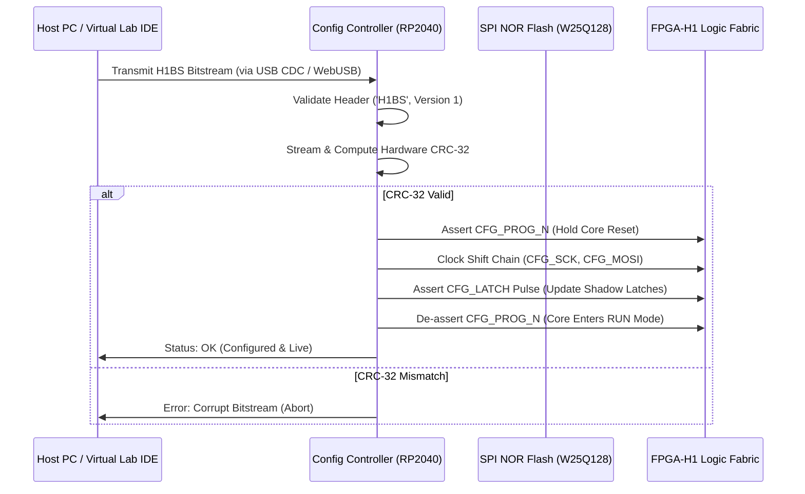
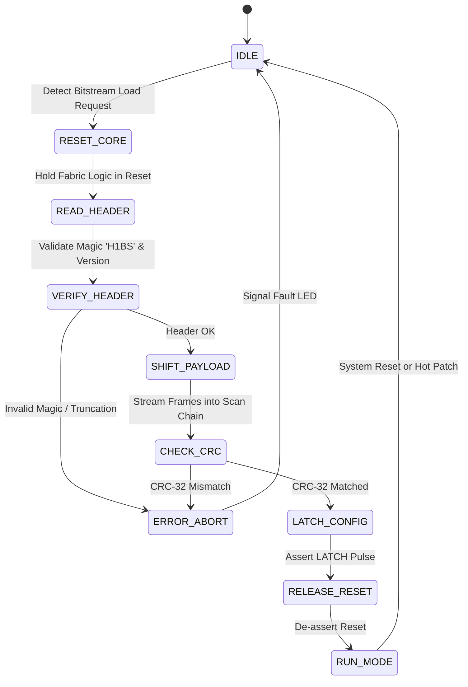

# FPGA-H1 — Phase 6: Configuration Controller Architecture & H1BS Physical Mapping

## 1. Configuration Controller Overview

The **Configuration Controller** is a dedicated digital management block decoupled from the programmable logic core. It is responsible for:
1. Bootstrapping configuration from external SPI NOR Flash or host PC.
2. Decompressing and deserializing the binary **H1BS bitstream**.
3. Real-time hardware CRC-32 verification (IEEE 802.3).
4. Driving the physical configuration scan chain or SRAM address decoders.
5. Managing system reset, clock gating, and hot dynamic logic reconfiguration.



---

## 2. Configuration Interface Protocol Evaluation

| Interface Standard | Transfer Rate | Pin Count | Protocol Complexity | Hardware Availability | Role in FPGA-H1 Architecture |
| :--- | :---: | :---: | :---: | :---: | :--- |
| **SPI (Master / Slave)** | Up to 62.5 Mbps | 4 pins | Low (Standard synchronous) | Universal on all MCUs & Flash | **Primary Configuration Bus** |
| **JTAG (IEEE 1149.1)** | 10 – 30 Mbps | 4–5 pins | Moderate (TAP state machine) | Standard boundary scan | Secondary Silicon Debug Bus |
| **UART (Serial)** | Up to 3 Mbps | 2 pins | Low | Universal | Host Debug / Telemetry logging |
| **USB 2.0 Full Speed** | 12 Mbps | 2 pins | High (Requires USB stack) | Embedded on RP2040 | PC Host Connection Interface |
| **Parallel Passive (x8)**| > 100 Mbps | 12–16 pins | Very Low | Needs wide pinout | High-speed multi-chip cluster bus |

---

## 3. Evaluation of the RP2040 as Initial Configuration Bridge

For prototype development, the **Raspberry Pi RP2040 microcontroller** is evaluated as the companion configuration bridge for `FPGA-H1-PROTOTYPE-001` and `FPGA-H1-PROTOTYPE-004`:

### Technical Capabilities
- **Dual ARM Cortex-M0+ cores @ 133 MHz**: Core 0 handles USB CDC communication with the H1 Virtual Lab IDE; Core 1 executes deterministic bitstream shift timing.
- **Programmable I/O (PIO)**: Dedicated PIO state machines can drive custom scan-chain clocking and latching waveforms at full clock speed with zero CPU jitter.
- **Hardware SPI**: Master mode transfers up to $62.5\text{ Mbps}$, loading the 1 CLB prototype in $< 20 \ \mu\text{s}$ and a full $57\text{ KB}$ bitstream in $< 8\text{ ms}$.
- **Decoupling Boundary**: The RP2040 is strictly an **external supervisor**; it generates no runtime logic functions and can be replaced by a simple SPI flash state machine in production silicon.

---

## 4. Bootloader State Machine

The physical controller implements a deterministic 8-state hardware state machine:



---

## 5. H1BS Bitstream Frame to Physical Resource Mapping

### 5.1 Full-Scale Matrix Reconciliation ($47 \times 47$ Grid, 8,836 LUTs)
In Phase 5, the total uncompressed configuration capacity was calculated as **455,196 bits** ($\approx 56.9\text{ KB}$). The table below maps these bits to concrete physical hardware structures:

| Hardware Resource Group | Physical Primitive | Number of Tiles | Bits per Tile | Total Configuration Bits | Physical Destination |
| :--- | :--- | :---: | :---: | :---: | :--- |
| **LUT4 Truth Tables** | 16-bit SRAM array | 8,836 LUT4s | 16 bits | **141,376 bits** | LUT4 multiplexer select memory |
| **BLE Architecture** | Bypass MUX & Inverters | 8,836 BLEs | 3 bits | **26,508 bits** | BLE bypass MUX & polarity latches |
| **Connection Boxes (CB)** | Track Multiplexers & Drivers | 4,512 CBs | 39.17 bits avg | **176,720 bits** | CB Input MUX select & output enables |
| **Wilton Switch Boxes (SB)**| Bilateral Transmission Gates | 2,304 SBs | 48 bits | **110,592 bits** | Wilton bilateral switch gate latches |
| **Total Physical Bits** | — | — | — | **455,196 bits** | Exact match with Phase 5 inventory |

### 5.2 Mapping for 1 CLB Prototype (`FPGA-H1-PROTOTYPE-001`)
The 1 CLB standalone board contains exactly:
- 4 LUT4s: $4 \times 16 \text{ bits} = 64 \text{ bits}$
- 4 BLE Bypass bits: $4 \times 1 \text{ bit} = 4 \text{ bits}$
- Total: **68 Configuration Bits** (packed into 9 bytes).

```
Scan Chain Serial Bit Order for FPGA-H1-PROTOTYPE-001:
Bit [00..15] : BLE 0 LUT4 Mask (16 bits)
Bit [16..31] : BLE 1 LUT4 Mask (16 bits)
Bit [32..47] : BLE 2 LUT4 Mask (16 bits)
Bit [48..63] : BLE 3 LUT4 Mask (16 bits)
Bit [64]     : BLE 0 Bypass (1 = Combinational, 0 = DFF)
Bit [65]     : BLE 1 Bypass
Bit [66]     : BLE 2 Bypass
Bit [67]     : BLE 3 Bypass
Bits [68..71]: Padding (0000) to round to exactly 9 bytes.
```
