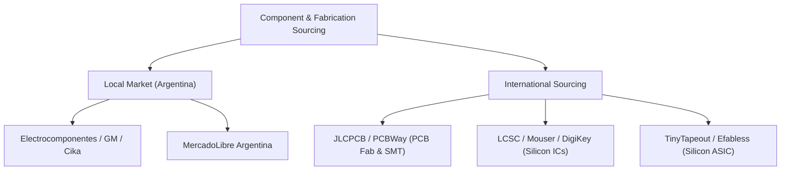

# FPGA-H1 — Phase 6: Economic Evaluation & Cost Estimation

## 1. Executive Summary & Cost Framework

Economic viability is a core pillar of the FPGA-H1 mission: designing an experimental programmable logic device that is accessible, reproducible, and verifiable.

This document analyzes the exact costs for:
1. **1 CLB Prototype (`FPGA-H1-PROTOTYPE-001`)**
2. **4 CLB Mesh Prototype (`FPGA-H1-PROTOTYPE-004`)**
3. **16 CLB Discrete Array**
4. **Custom Silicon ASIC Shuttles (TinyTapeout & Efabless ChipIgnite)**

> [!IMPORTANT]
> **Strict Engineering Pricing Distinction**: All prices listed below distinguish between **Verified Real Market Prices** (checked on distributor catalogs: Mouser, DigiKey, LCSC, Electrocomponentes, MercadoLibre) and **Estimated Operational Costs** (shipping, customs tariffs, assembly labor).

---

## 2. Procurement Channels & Local vs International Availability

### 2.1 Argentine Local Distributors (Immediate Availability)
- **Electrocomponentes / GM Electrónica / Cika**:
  - 74HC series ICs (74HC595, 74HC74, 74HC157, 74HC4067) in DIP and SOIC packages are in continuous stock.
  - Typical local retail pricing: \$0.80 to \$1.80 USD equivalent per IC (in ARS at official/MEP rate).
  - Raspberry Pi Pico (RP2040): In stock locally (\$6,500 – \$9,500 ARS, approx. \$6.00 – \$8.50 USD).
- **Advantage**: Delivery within 24–48 hours; zero international customs paperwork.

### 2.2 International Sourcing (LCSC / JLCPCB / Mouser)
- Direct SMD parts in reel/tube quantities:
  - 74HC4067 (TSSOP-24): \$0.35 – \$0.65 USD.
  - 74HC595 (SOIC-16): \$0.12 – \$0.22 USD.
  - 74HC74 (SOIC-14): \$0.10 – \$0.18 USD.
- Quick-turn 2-layer PCBs: \$2.00 to \$5.00 USD for 5 boards.

---

## 3. Detailed Cost Breakdown by Physical Architecture

### 3.1 1-CLB Discrete Prototype (`FPGA-H1-PROTOTYPE-001`, 4 LUT4, 4 DFF)

| Category / Component | Sourcing Channel | Status | Unit Cost (USD) | Qty | Total Cost (USD) | Total Cost (ARS @ MEP $1,150) |
| :--- | :--- | :--- | :---: | :---: | :---: | :---: |
| **74HC4067 (16:1 Mux)** | LCSC / Local | **Verified** | $0.65 | 4 | $2.60 | $2,990 |
| **74HC595 (Shift Reg)** | LCSC / Local | **Verified** | $0.18 | 9 | $1.62 | $1,863 |
| **74HC74 (Dual DFF)** | LCSC / Local | **Verified** | $0.15 | 2 | $0.30 | $345 |
| **74HC157 (Quad 2:1 Mux)** | LCSC / Local | **Verified** | $0.20 | 2 | $0.40 | $460 |
| **RP2040 Config Bridge**| MercadoLibre / Pi Pico | **Verified** | $6.50 | 1 | $6.50 | $7,475 |
| **Passives (Caps, Res, LEDs)**| Local Stock | **Verified** | $0.80 | 1 kit | $0.80 | $920 |
| **Headers & Terminals** | Local Stock | **Verified** | $0.70 | 1 set | $0.70 | $805 |
| **Custom 2-Layer PCB** | JLCPCB (5 pcs) | **Verified** | $2.00 | 1 board | $2.00 | $2,300 |
| **Estimated Shipping/Tariff**| Standard Post / Courier | Estimated | $6.00 | — | $6.00 | $6,900 |
| **TOTAL (1 CLB Board)** | — | — | — | — | **$20.92 USD** | **$24,058 ARS** |

---

### 3.2 4-CLB Mesh Prototype (`FPGA-H1-PROTOTYPE-004`, 16 LUT4, 16 DFF, 4 Switch Boxes)

| Category / Component | Part Type | Qty | Unit Cost (USD) | Total Cost (USD) | Total Cost (ARS @ MEP $1,150) |
| :--- | :--- | :---: | :---: | :---: | :---: |
| **Logic ICs (CLB Array)** | 74HC4067, 595, 74, 157 | 68 ICs | $0.28 avg | $19.04 | $21,896 |
| **Routing Switch Boxes** | 74CBT3257 (Bus Switches)| 16 ICs | $0.35 | $5.60 | $6,440 |
| **Controller Bridge** | RP2040 Pico | 1 module | $6.50 | $6.50 | $7,475 |
| **Decoupling & Connectors**| Passives & Pin Headers | 1 set | $3.50 | $3.50 | $4,025 |
| **4-Layer PCB Fabrication**| JLCPCB (120x120mm, 5 pcs) | 1 board | $12.00 | $12.00 | $13,800 |
| **Estimated Shipping & Courier**| DHL Express / Fedex | Estimated | $22.00 | $22.00 | $25,300 |
| **TOTAL (4 CLB Prototype)** | — | — | — | **$68.64 USD** | **$78,936 ARS** |

---

### 3.3 16-CLB Array (Scalability Limit)

| Component Group | Active Components | Estimated Fabrication Cost (USD) | Practical Assessment |
| :--- | :---: | :---: | :--- |
| **336 Active ICs + PCB** | Discrete SSI/MSI | **$240 – $310 USD** | Economically unviable compared to low-cost FPGAs; high assembly risk. |

---

### 3.4 Custom Silicon ASIC Shuttles (SkyWater 130nm)

| Shuttle Program | Capacity / Die Area | Fabric Capacity | Total Program Cost (USD) | Turnaround Time |
| :--- | :--- | :---: | :---: | :---: |
| **TinyTapeout Shuttle** | Single tile ($160 \times 100 \ \mu\text{m}$) | 1 to 4 CLBs (4 to 16 LUT4s) | **$300 – $450 USD** | 4 – 5 months |
| **TinyTapeout Multi-tile ($2\times 2$)** | Quad tile ($320 \times 200 \ \mu\text{m}$) | 8 to 16 CLBs (32 to 64 LUT4s) | **$900 – $1,200 USD** | 4 – 5 months |
| **Efabless ChipIgnite** | Full $10 \text{ mm}^2$ monolithic die | 1,024 to 2,048 LUT4s | **$9,750 USD** (100 QFN parts) | 5 – 6 months |

---

## 4. Economic Synthesis & Recommendation

1. **Phase 6 Practical Construction**: The **`FPGA-H1-PROTOTYPE-001` (1 CLB)** can be fabricated and assembled for under **$21 USD ($24,000 ARS)** using parts readily available locally in Argentina.
2. **Intermediate Research**: The **`FPGA-H1-PROTOTYPE-004` (4 CLB)** costs **~$68 USD**, providing a complete physical Wilton routing matrix at a fraction of commercial development board costs.
3. **Silicon Roadmap**: Open-source **TinyTapeout ($300 USD)** represents the most cost-effective path to physical silicon tapeout.
