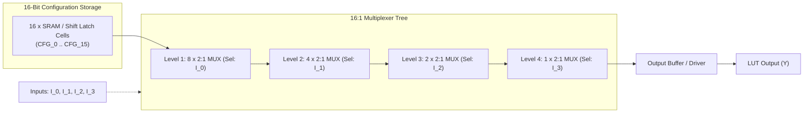

# FPGA-H1 — Phase 6: Physical LUT4 Design & Memory Architecture

## 1. Physical LUT4 Functional Architecture

The FPGA-H1 4-input Look-Up Table (LUT4) is the fundamental combinational building block of the architecture. Physically, it consists of:
1. A **16-bit configuration storage memory** holding the Boolean truth table.
2. A **16-to-1 Multiplexer tree** steered by the 4 logical inputs $I_0, I_1, I_2, I_3$.
3. An output buffer stage providing drive strength and level restoration.



---

## 2. Multiplexer Tree Topologies: Silicon vs Discrete

### 2.1 Silicon Implementation (CMOS Transmission Gates)
In custom CMOS integrated circuits (e.g. SkyWater 130nm), each 2:1 multiplexer is built using complementary transmission gates (TG):
- Each TG consists of 1 NMOS and 1 PMOS in parallel with an inverter for complementary gating:
  $$Y = (S \land B) \lor (\overline{S} \land A)$$
- A 16:1 multiplexer tree requires:
  $$\text{Level 1: } 8 \text{ TGs} \implies \text{Level 2: } 4 \text{ TGs} \implies \text{Level 3: } 2 \text{ TGs} \implies \text{Level 4: } 1 \text{ TG}$$
  Total TGs: $8 + 4 + 2 + 1 = 15$ dual-switch pairs (60 transistors total).
- **Latency**: Signal traverses 4 pass-transistor stages, yielding $t_{pd} \approx 0.45\text{ ns}$ in 130nm CMOS.

### 2.2 Discrete Implementation (Off-The-Shelf ICs)
For the discrete physical prototype (`FPGA-H1-PROTOTYPE-001`), two implementations were evaluated:
- **Option 1: 74HC4067 (Single-Chip 16-Channel Analog/Digital Multiplexer)**:
  - 16 input pins connected directly to the 16 configuration bits.
  - 4 address select pins $S_0, S_1, S_2, S_3$ driven by $I_0, I_1, I_2, I_3$.
  - Output pin $Z$ provides the combinational evaluation.
  - **Advantages**: Single 24-pin IC (TSSOP-24 or DIP-24); direct 1-to-1 mapping.
  - **Propagation Delay**: $t_{pd} \approx 14\text{ ns}$ at $V_{CC} = 5.0\text{V}$ (or $28\text{ ns}$ at $3.3\text{V}$).
- **Option 2: Dual 74HC151 (8:1 MUX) + 74HC157 (2:1 MUX)**:
  - Requires 3 ICs per LUT4. Higher PCB footprint and routing congestion.
- **Selection**: The **74HC4067** is selected as the primary discrete 16:1 multiplexer for `FPGA-H1-PROTOTYPE-001`.

---

## 3. Configuration Storage Technology Evaluation

Four configuration memory technologies were compared to store the 16-bit mask:

| Technology | Cell Structure | Area ($F^2$) | Static Leakage | Write Protocol | Read Speed | Manufacturing Ease |
| :--- | :--- | :---: | :---: | :--- | :---: | :--- |
| **6T SRAM** | 2 cross-coupled inverters + 2 access NMOS | ~120 – 140 | Low (~1 pW/cell) | Word line + Bit line pulse | < 0.5 ns | High (Standard CMOS logic process) |
| **D-Latch Scan Chain** | Static master-slave latch with scan mux | ~400 – 600 | Low (~5 pW/cell) | Serial shift clock (`SCK`) | < 0.2 ns | Highest (Pure standard cells, no custom analog) |
| **Discrete Shift Register (74HC595)**| 8-bit serial-in, parallel-out with storage latch | Discrete DIP/SOIC | Moderate (~100 $\mu\text{W}$) | Serial SPI shift + Latch pulse | 15 ns | Instant (Available globally off-the-shelf) |
| **Flash / EEPROM** | Floating gate / charge-trap transistor | ~30 – 50 | Near Zero | High-voltage tunnel ($> 10\text{V}$) | 10 – 30 ns | Very Low (Requires specialized high-voltage foundry) |

### Decision
1. **Discrete Hardware Prototype**: Use two **74HC595** 8-bit shift registers per LUT4 (16 parallel Q-outputs directly driving the 16 inputs of the 74HC4067 multiplexer).
2. **Silicon Implementation**: Use standard-cell **Scan Chain Latches** with shadow configuration registers for glitchless hot-reconfiguration.

---

## 4. H1BS Mask Serialization to Physical Hardware

When the H1L compiler compiles a Boolean expression (e.g. `ASSIGN Y = A ^ B`), it generates a 16-bit mask (e.g. `0x6996`).

### Transformation Pipeline: H1BS to Physical Bits

```
H1BS Mask Word: 0x6996  -->  Binary: 0110 1001 1001 0110
                                    ^               ^
                                    Bit 15          Bit 0
```

1. **Serialization**: The Configuration Controller transmits the 16 bits in Big Endian sequence (MSB bit 15 first down to LSB bit 0) over the SPI serial data line (`MOSI`).
2. **Shift Operation**: With each rising edge of `SCK`, the bits shift through the 74HC595 cascade:
   - `MOSI` $\to$ `DS` (IC1, 74HC595 #1) $\to$ `Q7S` $\to$ `DS` (IC2, 74HC595 #2).
3. **Glitch-Free Latching (`RCLK` Pulse)**:
   - While shifting, output registers hold their prior state (`OE` enabled).
   - Once all 16 bits are clocked in, the controller asserts a positive pulse on `RCLK` (Register Clock / Latch).
   - All 16 parallel outputs $Q_A..Q_H$ of both 74HC595 ICs update simultaneously in $< 15\text{ ns}$.
4. **Physical Truth Table Alignment**:
   - For an input vector $\vec{I} = (I_3, I_2, I_1, I_0) = (1, 0, 0, 1) \implies \text{Address } 9$.
   - Address pin $S_3=1, S_2=0, S_1=0, S_0=1$ selects channel $I_9$.
   - Channel $I_9$ connects to $Q_B$ of IC2 (bit 9 of mask = `0`). Output $Y = 0$.

```
Physical Mapping Table:
74HC595 Pin    Mask Bit    Function for 0x6996 (XOR)
IC1 Q_A         Bit 0       0
IC1 Q_B         Bit 1       1
IC1 Q_C         Bit 2       1
IC1 Q_D         Bit 3       0
...             ...         ...
IC2 Q_G         Bit 14      1
IC2 Q_H         Bit 15      0
```
