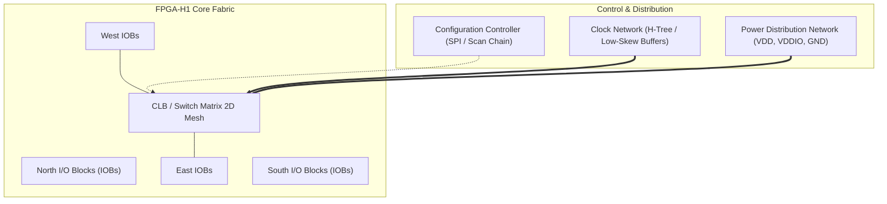
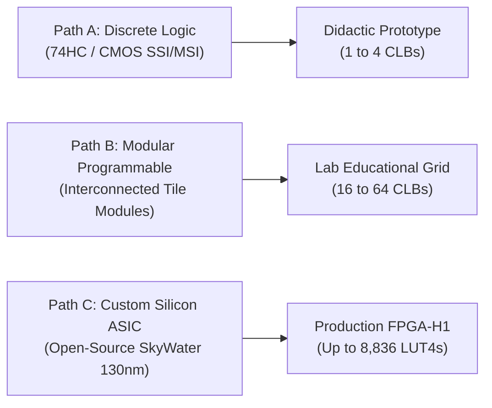

# FPGA-H1 — Phase 6: Physical Architecture & Hardware Feasibility

## 1. Executive Summary & Feasibility Mandate

The **FPGA-H1 Virtual Lab** achieved a complete, formally verified digital architecture in Phase 5, proving 100% mathematical equivalence across its compiler, placement, routing, bitstream, and discrete simulation engine for up to **8,836 LUT4s** (matching the nominal capacity of a Gowin GW1NR-9).

The objective of **Phase 6: Physical Architecture & Hardware Feasibility** is to define the engineering specification required to transition FPGA-H1 from a virtual simulation into **physical, real-world programmable hardware**.

> [!IMPORTANT]
> **Engineering Rule of Integrity**: Moving from 8,836 virtual LUTs to physical hardware is non-trivial. Discrete logic cannot scale to thousands of LUTs without geometric explosion of parts, and custom silicon requires strict verification of foundry design rules (DRC/LVS). We must not claim physical capacity without empirical hardware validation.

---

## 2. Virtual Abstraction vs Physical Reality Gap Analysis

Before translating virtual structures into schematics, an engineering audit establishes what has a direct physical equivalent versus what was a simulation abstraction:

| Virtual Primitive (Phases 1–5) | Simulation Abstraction in Python | Physical Real-World Implementation |
| :--- | :--- | :--- |
| **LUT4 Look-Up Table** | 16-bit integer mask evaluated via bit-shift `(mask >> idx) & 1` | 16-bit SRAM storage cell array + 16:1 Transmission Gate Multiplexer tree |
| **BLE Multiplexers** | Python ternary `lut_out if bypass else dff.q` | 2:1 CMOS multiplexer driven by a dedicated configuration SRAM cell |
| **D-Type Flip-Flop (DFF)** | Object tracking `last_clk` and state updates on `0 -> 1` | Master-Slave dynamic/static DFF with transmission gates and clock inverters |
| **Carry Chain** | Dedicated logic expression in Python | Dedicated hard multiplexer (`MAJ3`/`XOR`) with fast silicon look-ahead wire |
| **Wilton Switch Box** | Direction dictionary `(Side, Track) -> (Side, Track)` | Bidirectional CMOS transmission gate matrix or 4:1 multiplexer banks |
| **Connection Box** | Python set of allowed tracks `allowed_input_tracks` | Interleaved multiplexer banks for inputs; tri-state buffers for outputs |
| **Routing Channels** | Zero-latency, zero-resistance graph edges | Metal layer tracks (Metal 3/Metal 4) with finite sheet resistance ($R$) and parasitic capacitance ($C$) |
| **Global Clock** | Instantaneous synchronous event across all BLEs | Balanced physical H-tree distribution network with skew buffers |
| **H1BS Bitstream Loading** | `bytearray` parsed in Python into memory structures | Serial SPI scan chain / 2D addressable word-line configuration array |

---

## 3. High-Level Physical Architecture of FPGA-H1

The physical FPGA-H1 fabric adopts an **Island-Style Architecture** comprising five fundamental subsystems:

1. **Configurable Logic Blocks (CLBs)**: Uniform logic tiles distributed in a 2D rectilinear grid. Each CLB contains 4 Basic Logic Elements (BLEs), local routing, and fast carry propagation.
2. **Routing Channels & Switch Blocks**:
   - **Horizontal Channels (CHANX)** and **Vertical Channels (CHANY)** running between CLBs with track count $W=8$.
   - **Wilton Switch Boxes (SB)** located at every grid intersection ($F_s = 3$).
   - **Connection Boxes (CB)** bridging channel tracks to CLB input/output pins ($F_c = 0.5$).
3. **Perimeter I/O Blocks (IOBs)**: Dedicated pad drivers surrounding the core grid, providing TTL/LVCMOS 3.3V/1.8V level conversion, tri-state control, and ESD protection.
4. **Configuration Infrastructure**:
   - Shift-register scan chain or SRAM address decoder.
   - Master/Slave SPI configuration controller with hardware CRC-32 validation.
5. **Clock & Reset Distribution**:
   - Balanced low-skew tree delivering uniform edges to all DFFs.

---

## 4. Evaluation of the Three Technological Pathways

To achieve a physical FPGA-H1 device, three distinct physical architectures were investigated:

### Summary of Architectural Pathways

| Feature / Metric | Path A: Discrete Logic | Path B: Modular Programmable | Path C: Custom Silicon ASIC |
| :--- | :--- | :--- | :--- |
| **Implementation Technology** | 74HC series ICs on FR4 PCB | Modular PCB tiles + micro-CPLDs/RP2040 | Monolithic CMOS (SkyWater 130nm) |
| **Logic Density** | ~0.05 LUT4 / $\text{cm}^2$ | ~0.5 LUT4 / $\text{cm}^2$ | > 50,000 LUT4 / $\text{cm}^2$ |
| **Maximum Feasible Scale** | **1 to 4 CLBs** (4 to 16 LUT4) | **16 to 64 CLBs** (64 to 256 LUT4) | **Up to 8,836 LUT4s** ($47 \times 47$) |
| **Maximum Operating Frequency** | 5 – 10 MHz | 15 – 25 MHz | 100 – 150 MHz |
| **Power Consumption per LUT** | ~15 – 30 mW | ~5 – 10 mW | ~5 – 10 $\mu\text{W}$ |
| **Unit Fabrication Cost** | $15 – $40 (1 CLB) | $100 – $250 (System) | Shuttle: $300 (TinyTapeout) / $9,750 (Full) |
| **Development Complexity** | Low (Schematic & standard PCB) | Moderate (Board-to-board routing) | High (Full OpenLane RTL-to-GDSII flow) |
| **Primary Value** | **Immediate physical proof-of-concept** | Intermediate experimental clustering | **Ultimate goal matching GW1NR-9** |

---

## 5. Architectural Decision & Phased Roadmap

### Decision
1. **Initial Hardware Bring-Up (Phase 6)**: Implement **Path A (Discrete Architecture)** as a **1 CLB Minimum Physical Prototype (`FPGA-H1-PROTOTYPE-001`)** with 4 LUT4s and 4 DFFs configured via SPI from an RP2040 configuration bridge.
2. **Intermediate Scalability**: Evaluate **Path B (Modular Interconnect)** for clustering up to 4 CLBs on a 4-layer PCB.
3. **Silicon Tapeout Strategy**: Simultaneously prepare the synthesizable Verilog core for **Path C (Custom Silicon ASIC)** targeting open shuttles (TinyTapeout / Efabless ChipIgnite SkyWater 130nm).
