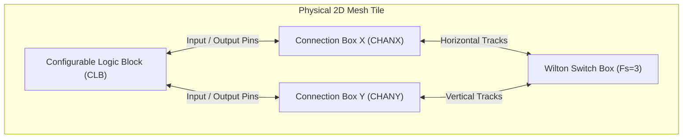
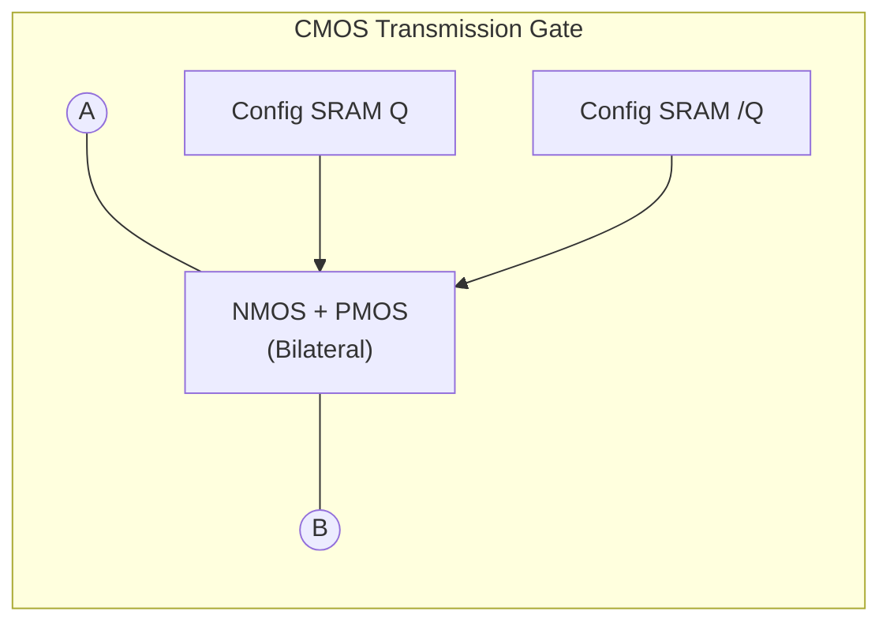

# FPGA-H1 — Phase 6: Physical Interconnect Architecture (Switch & Connection Boxes)

## 1. Physical Interconnect Overview

In an Island-Style FPGA, programmable interconnect consumes between **60% and 80%** of total silicon area and propagation delay. Accurately translating virtual routing algorithms into physical transmission structures is crucial for timing closure and electrical stability.



---

## 2. Physical Wilton Switch Box ($F_s = 3$) Implementation

A Wilton Switch Box interconnects horizontal and vertical channel tracks at every grid intersection. For a channel width $W=8$, each switch box terminates **32 wire terminals**:
- 8 North ($N_0..N_7$), 8 East ($E_0..E_7$), 8 South ($S_0..S_7$), 8 West ($W_0..W_7$).

### 2.1 Wilton Interconnection Topology Equations
For track index $t \in [0, W-1]$:
$$\begin{aligned}
T_{\text{left}}(t) &= t \quad (\text{Straight path}) \\
T_{\text{right}}(t) &= (t + 1) \pmod W \quad (\text{Diagonal right}) \\
T_{\text{opp}}(t) &= (t + W - 1) \pmod W \quad (\text{Diagonal left})
\end{aligned}$$

With flexibility $F_s = 3$, every incoming track can connect to exactly 3 candidate outgoing tracks.
$$\text{Total Bidirectional Switches per Switch Box} = W \times 6 = 8 \times 6 = \mathbf{48 \text{ Switches}}$$

### 2.2 Physical Switch Circuitry



1. **Silicon ASIC Implementation (SkyWater 130nm)**:
   - Each switch is a complementary **CMOS Transmission Gate (TG)** controlled by a 1-bit static RAM cell:
     - On-resistance: $R_{\text{on}} \approx 180 \ \Omega$.
     - Source/Drain parasitic capacitance: $C_d \approx 2.4 \text{ fF}$.
   - 48 switches $\implies 48$ SRAM cells per switch box tile.
2. **Discrete Prototype Implementation**:
   - For a 1 CLB standalone board (`FPGA-H1-PROTOTYPE-001`), the CLB connects directly to external header pins.
   - For multi-CLB expansion (e.g. 4 CLB `FPGA-H1-PROTOTYPE-004`):
     - Uses **74CBT3257 / 74CBT3245 (High-Speed CMOS Bus Switches)** or **CD74HC4066 (Quad Bilateral Analog Switches)**.
     - With low on-resistance ($R_{\text{on}} \approx 5 \ \Omega$ for 74CBT), signal delay through the switch is $< 0.25\text{ ns}$.

---

## 3. Physical Connection Box (CB) Implementation

Connection Boxes connect logic pins of adjacent CLBs to routing channel tracks.

### 3.1 Input Connection Box (Input Multiplexers)
Each of the 16 CLB logic inputs connects to a programmable multiplexer selecting from $F_{c,\text{in}} \cdot W$ channel tracks.
- For $W=8, F_{c,\text{in}}=0.5 \implies$ each input pin selects from **4 candidate tracks**.
- **Silicon Implementation**: 4:1 transmission-gate multiplexer steered by 2 SRAM configuration bits.
- **Discrete Implementation**: 74HC153 (Dual 4:1 Data Selector). Two 74HC153 ICs multiplex 4 input pins.

### 3.2 Output Connection Box (Tri-state Drivers)
Each of the 4 CLB outputs can drive $F_{c,\text{out}} \cdot W$ tracks ($F_{c,\text{out}}=0.5 \implies 4$ tracks).
- **Physical Exclusion Rule**: Multiple drivers asserting conflicting voltages on a single channel track create a short circuit ($V_{DD} \to \text{GND}$).
- **Hardware Protection Circuit**:
  - Each output driver utilizes a **Tri-State Buffer** (e.g. 74HC125 or ASIC tri-state inverter).
  - An active-low enable pin (`/OE`) is driven by the configuration memory.
  - The configuration protocol strictly checks that $\sum \text{Drivers per track} \le 1$ before enabling `/OE`.

---

## 4. Signal Integrity, Parasitics & Delay Model

A physical routing wire segment is distributed along PCB copper traces (or on-chip Metal 3/4 layers).

```
Model: Lumped R-C Pi Model per Track Segment
(Node A) ---[ R_wire / 2 ]----+---->---[ R_wire / 2 ]---> (Node B)
                              |
                            [ C_wire ]
                              |
                            (GND)
```

### Transmission Parameters Comparison

| Parameter | On-Chip Silicon (SkyWater 130nm) | Discrete FR4 PCB (Microstrip Trace) |
| :--- | :---: | :---: |
| **Track Sheet Resistance ($R$)** | $0.12 \ \Omega/\mu\text{m}$ | $0.008 \ \Omega/\text{cm}$ (Negligible) |
| **Track Capacitance ($C$)** | $0.18 \text{ fF}/\mu\text{m}$ | $1.2 \text{ pF}/\text{cm}$ |
| **Switch Resistance ($R_{\text{on}}$)**| $180 \ \Omega$ (TG) | $5 \ \Omega$ (74CBT Bus Switch) |
| **Segment Propagation Delay ($t_{pd}$)**| **$0.35\text{ ns}$ per hop** | **$1.8\text{ ns}$ per hop** |
| **Max Unbuffered Length** | 3 CLB hops (~$600 \ \mu\text{m}$) | 4 CLB hops (~$15 \text{ cm}$) |

### Buffer Insertion Strategy
When routing signals across more than 3 consecutive switch boxes, signal slew rate degrades exponentially ($t_{pd} \propto L^2$). To maintain sharp rise times ($t_r < 1\text{ ns}$):
- Directional buffer repeaters (inverter pairs) must be inserted every 3 switch matrix tiles on long global tracks.
