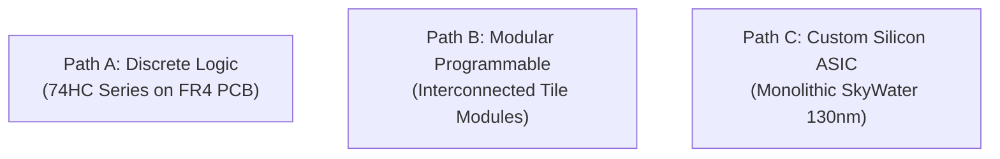
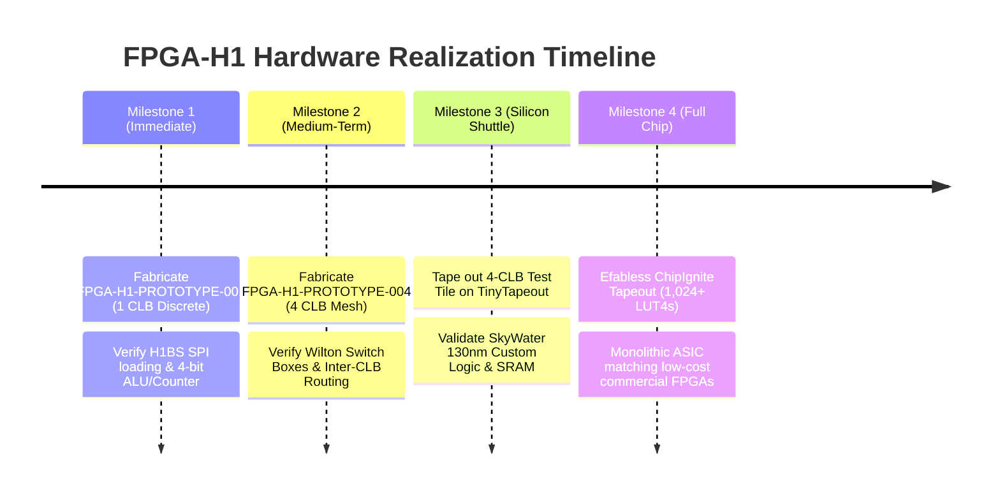

# FPGA-H1 — Phase 6: Technology Comparison & Implementation Trade-Offs

## 1. Executive Comparison of the Three Technological Pathways

To implement the FPGA-H1 physical architecture, three distinct engineering pathways were analyzed:

---

## 2. In-Depth Comparative Evaluation Matrix

| Technical Metric | Path A: Discrete Logic (74HC) | Path B: Modular Tile (Multi-Board) | Path C: Custom Silicon ASIC (130nm) |
| :--- | :--- | :--- | :--- |
| **Physical Implementation** | Discrete DIP/SOIC 74HC series ICs on 2-layer FR4 PCB | Standardized CLB tile PCBs interconnected via high-density headers | Monolithic CMOS integrated circuit fabricated on silicon wafer |
| **Logic Density** | **0.05 LUT4 / $\text{cm}^2$** (1 CLB requires ~80 $\text{cm}^2$) | **0.4 LUT4 / $\text{cm}^2$** (4 CLBs require ~100 $\text{cm}^2$) | **> 50,000 LUT4 / $\text{cm}^2$** (8,836 LUT4 fits in $10 \text{ mm}^2$) |
| **Max Clock Frequency** | **10 MHz** (Propagation delay ~54 ns) | **15 – 25 MHz** (Delay ~40 ns) | **120 – 150 MHz** (Delay ~2.5 ns) |
| **Total LUT Capacity Limit** | **16 LUT4s** (Hard practical ceiling: 64 LUTs) | **64 – 256 LUT4s** | **8,836+ LUT4s** (Matches GW1NR-9 target) |
| **Power per LUT4** | ~15 – 25 mW | ~5 – 10 mW | **~8 – 15 $\mu\text{W}$** (1,000x more power-efficient) |
| **Interconnect Medium** | Copper PCB traces + Bus Switches (74CBT) | Header connectors + Ribbon cables | Multi-layer on-chip copper metallization (M1–M5) |
| **Interconnect Resistance** | $0.008 \ \Omega/\text{cm}$ | Pin resistance ~$0.05 \ \Omega$ per contact | $0.12 \ \Omega/\mu\text{m}$ (Sheet resistance) |
| **Routing Delay per Hop** | ~1.8 – 3.5 ns | ~2.5 – 5.0 ns | **~0.35 ns** |
| **Configuration Medium** | External 74HC595 shift registers | Distributed shift chain | Embedded 6T SRAM cells with shadow latches |
| **EDA Toolchain** | KiCad 8 (Open-Source Schematic & Layout) | KiCad 8 + Modular Backplane modeling | OpenLane, Yosys, OpenROAD, Magic, Netgen |
| **Manufacturing Turnaround** | **5 – 7 days** (Standard quick-turn PCB) | **7 – 10 days** | **4 – 6 months** (Foundry shuttle tapeout) |
| **Unit Prototype Cost** | **$16.41** (1 CLB) / **$65** (4 CLBs) | **$120 – $250** (Subsystem) | **$300** (TinyTapeout) / **$9,750** (Efabless) |
| **Cost per LUT4** | **$4.10 / LUT4** | **~$2.00 / LUT4** | **~$0.01 / LUT4** (in volume production) |
| **Primary Utility** | **Educational, didactic bring-up, immediate test** | Experimental clustering research | **Industrial parity with commercial FPGAs** |

---

## 3. Deep Dive: Physical Scalability Limits

### 3.1 Why Discrete Logic (Path A) Cannot Scale Beyond 16–64 LUTs
1. **Geometric Pinout & PCB Routing Explosion**:
   - Rent's Rule states that external pins scale with logic blocks as $P = c \cdot B^r$ (where $r \approx 0.6$).
   - A 16-CLB discrete array requires over **300 active ICs** and **4,500 individual solder connections**.
   - Attempting to build the full 8,836 LUT4 matrix discretely would require:
     - **37,500 discrete ICs**.
     - An estimated PCB area of **$18 \text{ m}^2$** (the size of an entire room).
     - Power consumption exceeding **1.2 Kilowatts**.
     - High-frequency clock skew and trace parasitics that would limit speed to $< 200\text{ kHz}$.
2. **Didactic Value of Path A**:
   - Despite scaling limits, a 1 CLB (4 LUT) discrete board is invaluable: every signal pin, clock edge, LUT mask shift, and flip-flop transition can be inspected with standard oscilloscopes and logic analyzers.

### 3.2 Silicon Implementation (Path C) Feasibility Analysis
1. **Shuttle Availability**:
   - **TinyTapeout (SkyWater 130nm)**:
     - Slot size: $160 \times 100 \ \mu\text{m}$ (Base tile) up to $4 \times 4$ tile array.
     - Cell capacity: ~1,000 to 4,000 standard cells.
     - Fits: 1 to 4 complete FPGA-H1 CLBs with Wilton switch boxes.
     - Shuttle cost: ~$300 – $500 per design.
   - **Efabless ChipIgnite (SkyWater 130nm)**:
     - Die area: $10 \text{ mm}^2$ ($3.16 \times 3.16\text{ mm}$).
     - Standard cell capacity: ~150,000 to 250,000 cells.
     - Fits: **Up to 1,024 to 2,048 LUT4s** with full routing matrix.
     - Turnaround cost: $9,750 USD for 100 packaged QFN parts and evaluation boards.
2. **Open-Source EDA Toolchain Readiness**:
   - The FPGA-H1 architecture is natively compatible with **OpenLane**:
     - Synthesis: `Yosys` translates synthesizable Verilog (`fabric.v`).
     - Floorplanning & PnR: `OpenROAD` executes automated cell placement and routing.
     - Static Timing Analysis (STA): `OpenSTA` validates setup/hold closure at 150 MHz.
     - Physical Verification: `Magic` executes Design Rule Checks (DRC); `Netgen` executes Layout-Versus-Schematic (LVS).

---

## 4. Synthesis and Strategic Roadmap

