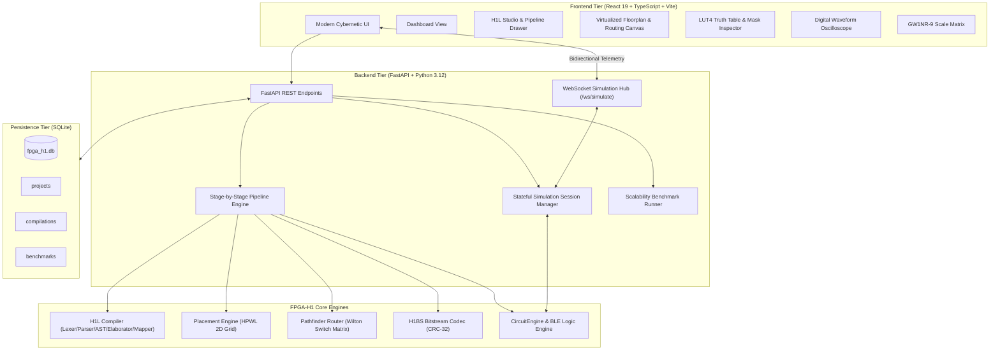

# FPGA-H1 Virtual Lab — Architecture Specification

## 1. Executive Summary

FPGA-H1 Virtual Lab is an integrated, production-grade graphical engineering environment designed to design, compile, synthesize, visualize, simulate, and debug custom Island-Style FPGA architectures.

Rather than relying on mock dashboards or static previews, FPGA-H1 Virtual Lab connects directly to the underlying silicon simulation and compilation engines:
- **H1L Compiler**: Lexer, Parser, AST, Elaborator, and Boolean Technology Mapper.
- **Physical Design Engine**: 2D Spatial Placement (Simulated Annealing HPWL) and Pathfinder Negotiated-Congestion Router with Wilton $F_s=3$ switch boxes.
- **H1BS Bitstream Codec**: Binary bitstream generator with 32-bit CRC validation.
- **Logic Simulation Engine**: Cycle-by-cycle topological logic evaluator with WebSocket streaming telemetry.

---

## 2. Multi-Tier System Architecture

---

## 3. Communication and Data Flow

### 3.1 Compilation & Synthesis Pipeline
1. The user inputs or edits H1L hardware description code in the H1L Studio.
2. Triggering **Build Bitstream** sends a `POST /api/compile` request with the source code and target routing channel width $W$.
3. The `PipelineExecution` orchestrates the 8 discrete compilation phases:
   - **Stage 1 (Lexer)**: Generates token stream.
   - **Stage 2 (Parser)**: Constructs abstract syntax tree (`DeviceNode`).
   - **Stage 3 (Elaborator)**: Resolves buses, types, registers, and detects multidriver conflicts.
   - **Stage 4 (Optimizer)**: Maps boolean equations and primitives into 16-bit LUT4 truth tables and sequential DFFs.
   - **Stage 5 (Netlist)**: Constructs `CircuitEngine` topological evaluation graph.
   - **Stage 6 (Placement)**: Assigns CLBs (4 BLEs per CLB) into a 2D spatial grid minimizing Half-Perimeter Wire Length (HPWL).
   - **Stage 7 (Routing)**: Routes netlist through Wilton switch boxes and channel tracks using negotiated congestion ($A^*$ Pathfinder).
   - **Stage 8 (Bitstream)**: Encodes frames, metadata, and calculates IEEE 802.3 CRC-32 checksum.
4. Intermediate metrics, execution durations (ms), and data models are persisted in SQLite and returned to the UI.
5. The compiled `CircuitEngine` and `GridCircuit` are automatically mounted into the `SimulationManager`.

### 3.2 Real-Time WebSocket Simulation Telemetry
1. The frontend initiates a WebSocket connection to `ws://localhost:8000/ws/simulate`.
2. Telemetry commands supported:
   - `STEP`: Advances one clock transition, evaluates topological logic, and updates outputs and internal BLE states.
   - `RUN`: Starts an asynchronous timer loop stepping at a chosen frequency (0.5 Hz to 20 Hz).
   - `PAUSE`: Halts clock ticking.
   - `RESET`: Clears sequential flip-flops and resets cycle counter $T=0$.
   - `SET_INPUTS`: Injects input pin stimulus vector without clock edge.
   - `SET_LUT_MASK`: Dynamically updates a BLE's 16-bit configuration mask in silicon memory on-the-fly.
3. Every step broadcasts a full state snapshot (`cycle`, `clk`, `inputs`, `outputs`, `ble_states`, `timestamp`) back to the client, driving the live Floorplan canvas and Digital Waveform Oscilloscope.

---

## 4. Concurrency & Performance Model

- **FastAPI Async Event Loop**: Handles non-blocking REST endpoints alongside WebSocket streaming tasks.
- **Virtualized Canvas Rendering**: Floorplan utilizes an HTML5 Canvas rendering engine with Level of Detail (LOD) culling. When zoomed out on large grids (such as the $47 \times 47$ Gowin GW1NR-9 reference scale), micro-details (BLE pins, track lines) are culled, maintaining steady 60 FPS performance without DOM bloat.
- **SQLite Single-File Store**: Zero-dependency local persistence for projects, compilation artifacts, and scalability benchmarks.
